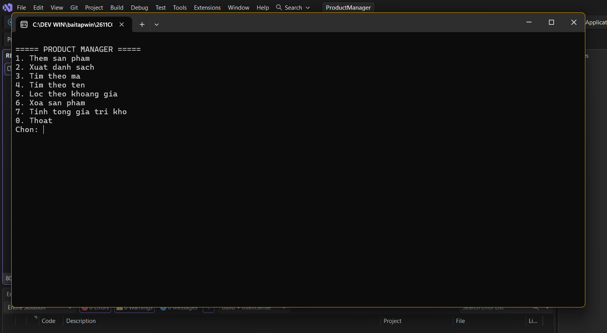
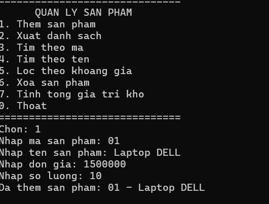
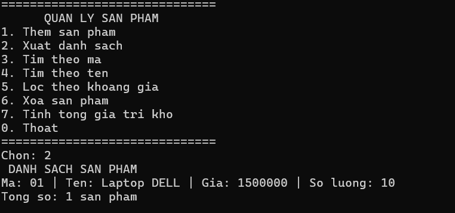
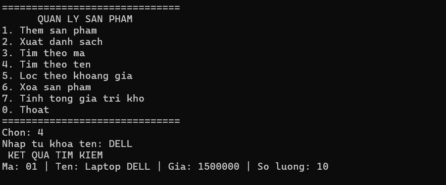
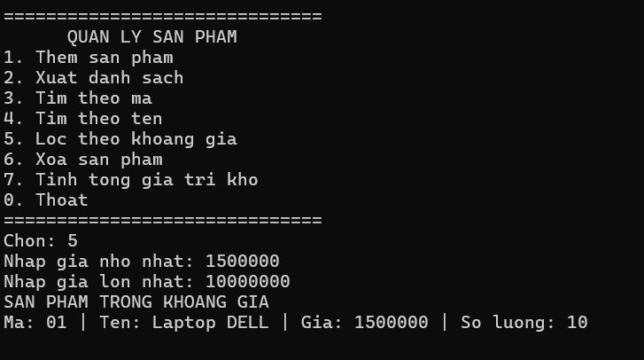
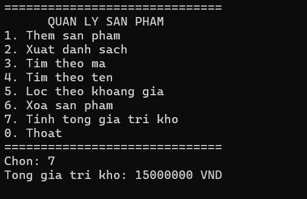
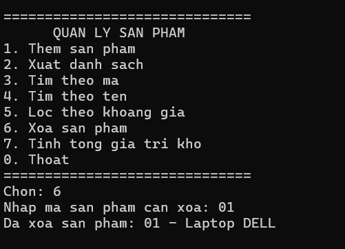

# Lab 04 – Product Manager (Console App C#)
## 2611COMP101904-Lap-trinh-Windows
## Bài Lab: Lab 04 - Product Manager
## Họ tên sinh viên: Hoàng Minh Nhật
## MSSV: 51.01.104.066
## Nhóm 5

---

## 1. Mục tiêu chương trình
Chương trình được xây dựng nhằm thực hành các kỹ năng:
- Xử lý lỗi bằng `try-catch`, `throw` và Exception tự tạo.
- Sử dụng `Event` để thông báo khi thêm hoặc xóa sản phẩm thành công.
- Sử dụng `Func<T, bool>` để tìm kiếm và lọc dữ liệu.
- Xây dựng Generic Class `Repository<T>`.
- Tách phần xử lý nghiệp vụ khỏi hàm `Main`.
- Quản lý danh sách sản phẩm thông qua giao diện Console.

## 2. Chức năng chính
| STT | Chức năng | Mô tả |
| :---: | :--- | :--- |
| **1** | **Thêm sản phẩm** | Nhập mã, tên, đơn giá và số lượng. |
| **2** | **Xuất danh sách** | Hiển thị toàn bộ sản phẩm đang có. |
| **3** | **Tìm theo mã** | Tìm sản phẩm dựa trên mã sản phẩm (chính xác). |
| **4** | **Tìm theo tên** | Tìm sản phẩm có tên chứa từ khóa. |
| **5** | **Lọc theo giá** | Lọc sản phẩm theo mức giá nhỏ nhất và lớn nhất. |
| **6** | **Xóa sản phẩm** | Xóa sản phẩm dựa trên mã. |
| **7** | **Tính tổng giá trị** | Tính tổng giá trị kho (Đơn giá × Số lượng). |
| **0** | **Thoát** | Kết thúc chương trình. |

## 3. Cấu trúc chương trình
- **`IEntity`**: Interface dùng để cung cấp mã định danh `Id` cho các đối tượng được quản lý bởi `Repository<T>`.
- **`SanPham`**: Class biểu diễn sản phẩm, gồm: `MaSP`, `TenSP`, `DonGia`, `SoLuong`. (Đơn giá và số lượng không được phép âm).
- **`TrungMaSanPhamException`**: Exception tự tạo, ném ra khi thêm sản phẩm có mã đã tồn tại.
- **`KhongTimThaySanPhamException`**: Exception tự tạo, ném ra khi không tìm thấy sản phẩm cần xóa.
- **`Repository<T>`**: Generic class dùng để quản lý danh sách đối tượng (`Them`, `Xoa`, `TimTheoMa`, `Tim`, `LayTatCa`).
- **`QuanLySanPham`**: Class xử lý nghiệp vụ chính của chương trình (Thêm, Xóa, Tìm kiếm, Lọc, Tính tổng giá trị kho, Phát Event).
- **`Program`**: Chứa hàm `Main`, hiển thị menu và các hàm nhập/xuất dữ liệu Console.

## 4. Xử lý ngoại lệ (Exception)
Chương trình bắt và xử lý các trường hợp lỗi chính:
- Mã sản phẩm bị trùng.
- Không tìm thấy sản phẩm.
- Mã hoặc tên sản phẩm bị bỏ trống.
- Đơn giá hoặc số lượng nhỏ hơn 0.
- Người dùng nhập sai kiểu dữ liệu (chữ thay vì số).


## 5. Event & Func
- **Event:** Sử dụng để thông báo khi thao tác thêm hoặc xóa sản phẩm thành công.
- **Func<SanPham, bool>:** Sử dụng để lọc dữ liệu. Ví dụ lọc theo khoảng giá:
  ```csharp
  return Loc(delegate (SanPham sanPham) {
      return sanPham.DonGia >= giaMin && sanPham.DonGia <= giaMax;
  });

## 6. Hình ảnh minh họa

### 6.1. Giao diện menu

### 6.2. Thêm sản phẩm

### 6.3. Xuất danh sách sản phẩm

### 6.4. Tìm kiếm sản phẩm

### 6.5. Lọc sản phẩm theo giá

### 6.6. Xóa sản phẩm

### 6.7. Xử lý Exception
