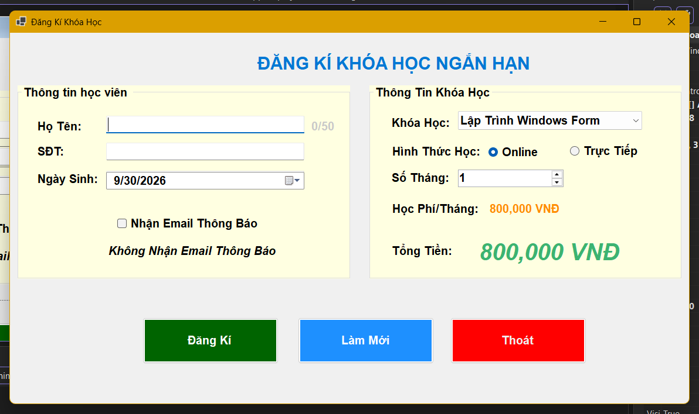
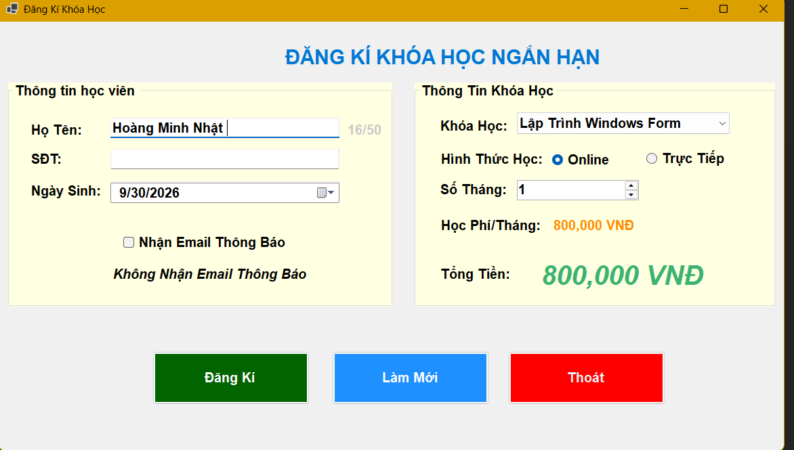
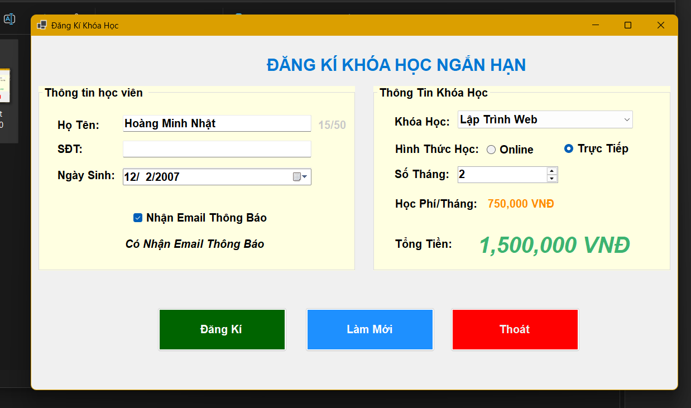
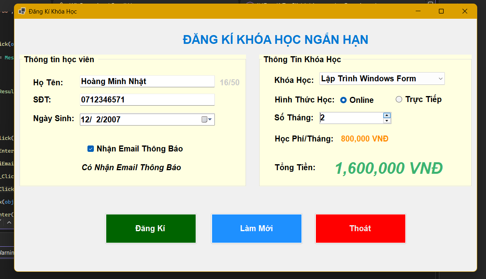
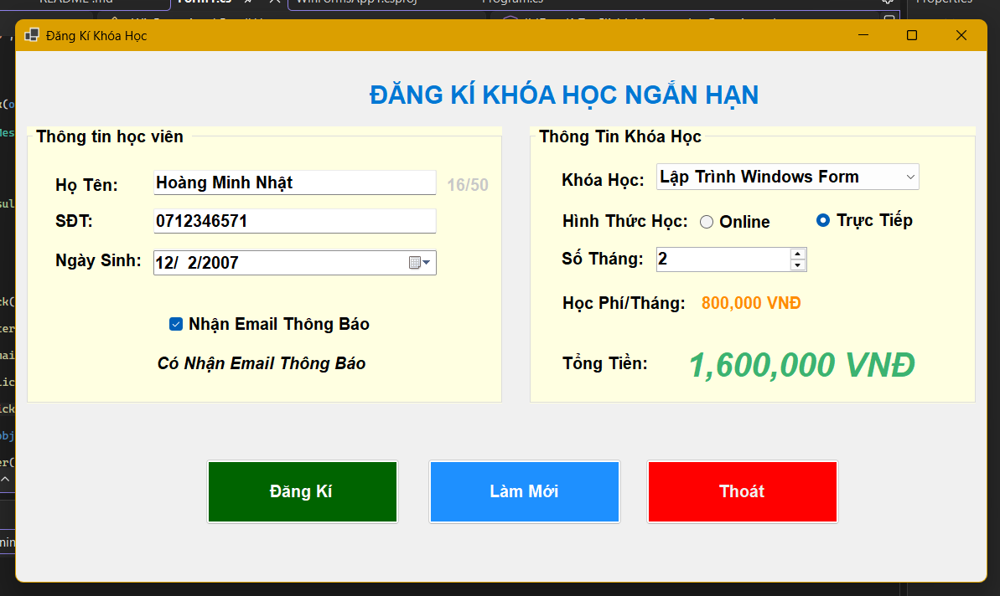
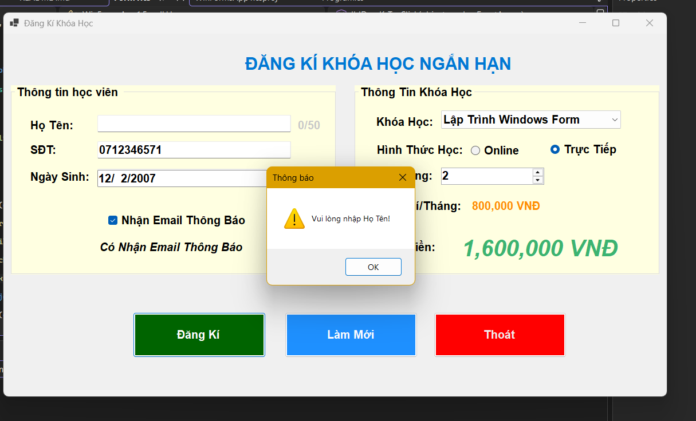
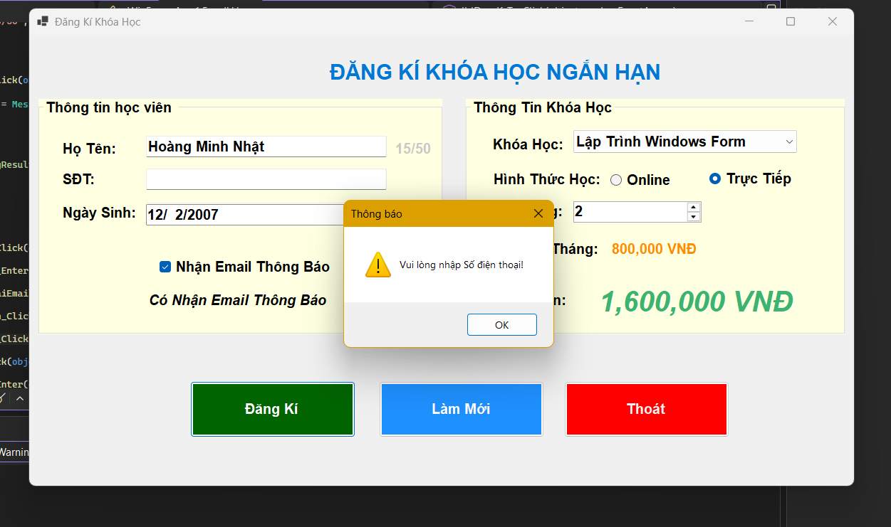
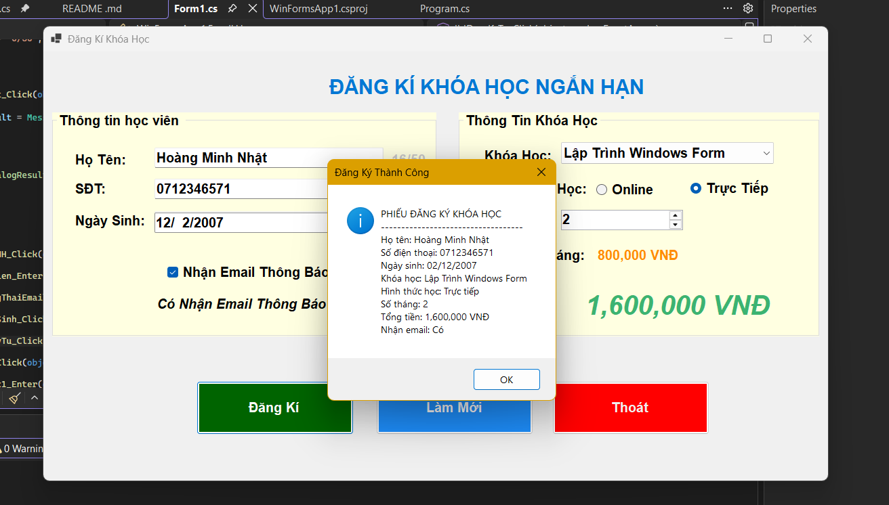
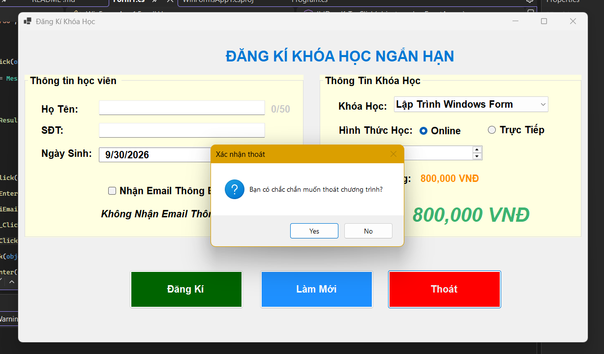

# LAB 05 - WINDOWS FORMS CƠ BẢN  
## 2611COMP101904-Lap-trinh-Windows
## Bài Lab: Lab 05 - Windows Forms Cơ Bản
## Họ tên sinh viên: Hoàng Minh Nhật
## MSSV: 51.01.104.066
## Nhóm 5

---

## 1. Giới thiệu

CourseRegistrationApp là ứng dụng Windows Forms viết bằng ngôn ngữ C#, dùng để đăng ký khóa học cho học viên.
Ứng dụng chỉ xử lý dữ liệu trực tiếp trên Form, **không lưu vào cơ sở dữ liệu**.

Người dùng nhập thông tin cá nhân, chọn khóa học, hình thức học và số tháng. Hệ thống tự tính tổng học phí và hiển thị phiếu đăng ký khi bấm nút **Đăng ký**.

## 2. Mục tiêu bài lab

- Tạo project Windows Forms App bằng C#.
- Thiết kế giao diện bằng Form Designer, Toolbox và Properties.
- Sử dụng các control cơ bản: Label, TextBox, Button, ComboBox, RadioButton, CheckBox, DateTimePicker, NumericUpDown, GroupBox.
- Đặt tên control theo quy ước để code dễ đọc.
- Xử lý các sự kiện: Click, Load, SelectedIndexChanged, ValueChanged, TextChanged.
- Kiểm tra dữ liệu nhập trước khi xử lý và hiển thị kết quả bằng MessageBox.


## 3. Cấu trúc thư mục

```
Thư-mục-repo/
├── README.md
├── images/                  # Ảnh minh họa cho báo cáo
├── WinFormsApp1.sln
└── WinFormsApp1/
    ├── Form1.cs           # Code xử lý sự kiện của Form
    ├── Form1.Designer.cs  # Code giao diện 
    └── Program.cs
```

## 4. Thiết kế giao diện

Form chính có tiêu đề **ĐĂNG KÝ KHÓA HỌC**, gồm 2 GroupBox và 1 vùng nút lệnh.

### 4.1. Nhóm "Thông tin học viên"

| Control | Tên control | Chức năng |
|---|---|---|
| TextBox | `txtHoTen` | Nhập họ tên học viên |
| Label | `lblDemKyTu` | Hiển thị số ký tự đã nhập của họ tên (dạng `x/50`) |
| TextBox | `txtSoDienThoai` | Nhập số điện thoại |
| DateTimePicker | `dtpNgaySinh` | Chọn ngày sinh |
| CheckBox | `chkNhanEmail` | Đăng ký nhận email thông báo |

### 4.2. Nhóm "Thông tin khóa học"

| Control | Tên control | Chức năng |
|---|---|---|
| ComboBox | `cboKhoaHoc` | Chọn khóa học |
| RadioButton | `radOnline` | Hình thức học online |
| RadioButton | `radOffline` | Hình thức học trực tiếp |
| NumericUpDown | `numSoThang` | Chọn số tháng đăng ký (từ 1 đến 12) |
| Label | `lblTongTien1` | Hiển thị tổng học phí |

### 4.3. Vùng nút lệnh

| Control | Tên control | Chức năng |
|---|---|---|
| Button | `btnDangKy` | Kiểm tra dữ liệu và hiển thị phiếu đăng ký |
| Button | `btnLamMoi` | Xóa dữ liệu, đưa Form về mặc định |
| Button | `btnThoat` | Thoát chương trình (có xác nhận) |

## 5. Dữ liệu khóa học

| Khóa học | Học phí / tháng |
|---|---|
| Lập Trình Windows Form | 800.000 VNĐ |
| Lập Trình Web | 750.000 VNĐ |
| Cơ Sở Dữ Liệu | 700.000 VNĐ |

Công thức tính: **Tổng học phí = Học phí một tháng x Số tháng đăng ký**

## 6. Các chức năng đã thực hiện

### 6.1. Khi Form Load (`Form1_Load`)

- Nạp danh sách khóa học vào ComboBox `cboKhoaHoc`.
- Chọn mặc định khóa học đầu tiên.
- Chọn mặc định hình thức **Online**.
- Thiết lập số tháng tối thiểu là **1**, tối đa là **12**.
- Đặt bộ đếm ký tự về `0/50`.
- Hiển thị tổng học phí ban đầu.
- Đưa con trỏ vào ô họ tên.

### 6.2. Tính học phí tự động

- Hàm `TinhTongTien()` tính tổng học phí dựa trên khóa học đang chọn và số tháng.
- Hàm `HienThiTongTien()` định dạng số tiền và hiển thị lên Label.
- Được gọi lại mỗi khi:
  - Đổi khóa học (`cboKhoaHoc_SelectedIndexChanged`).
  - Đổi số tháng (`numSoThang_ValueChanged`).

### 6.3. Đếm ký tự họ tên (chức năng thêm)

- Sự kiện `txtHoTen_TextChanged` cập nhật `lblDemKyTu` theo độ dài họ tên đang nhập, ví dụ `12/50`.

### 6.4. Nút Đăng ký (`btnDangKy_Click`)

Kiểm tra lần lượt, nếu sai thì báo lỗi bằng MessageBox, đưa con trỏ về ô bị lỗi và dừng xử lý:

1. Họ tên không được để trống.
2. Số điện thoại không được để trống.
3. Phải chọn khóa học.

Nếu hợp lệ, hiển thị **phiếu đăng ký** bằng MessageBox gồm: họ tên, số điện thoại, ngày sinh, khóa học, hình thức học, số tháng, tổng tiền và trạng thái nhận email.

### 6.5. Nút Làm mới (`btnLamMoi_Click`)

- Xóa họ tên và số điện thoại.
- Đưa ngày sinh về ngày hiện tại.
- Bỏ chọn nhận email.
- Chọn lại khóa học đầu tiên.
- Chọn lại hình thức Online.
- Đưa số tháng về 1.
- Đưa bộ đếm ký tự về `0/50`.
- Đưa con trỏ về ô họ tên.

### 6.6. Nút Thoát (`btnThoat_Click`)

- Hiển thị hộp thoại xác nhận trước khi thoát.
- Chỉ đóng Form khi người dùng chọn **Yes**.

## 7. Hình ảnh minh họa

### 7.1. Giao diện khi chạy chương trình (Form Load)



*Hình 1: Form sau khi Load - khóa học đầu tiên, Online, 1 tháng, tổng học phí ban đầu.*

### 7.2. Đếm ký tự khi nhập họ tên



*Hình 2: Label đếm ký tự thay đổi khi nhập họ tên.*

### 7.3. Tính học phí khi đổi khóa học



*Hình 3: Tổng học phí thay đổi khi chọn khóa học khác.*

### 7.4. Tính học phí khi đổi số tháng



*Hình 4: Tổng học phí thay đổi khi tăng/giảm số tháng.*

### 7.5. Chọn hình thức học Trực tiếp



*Hình 5: Chọn RadioButton Trực tiếp (Online tự bỏ chọn).*

### 7.6. Báo lỗi khi chưa nhập họ tên



*Hình 6: Thông báo khi để trống họ tên.*

### 7.7. Báo lỗi khi chưa nhập số điện thoại



*Hình 7: Thông báo khi để trống số điện thoại.*

### 7.8. Phiếu đăng ký thành công



*Hình 9: MessageBox hiển thị phiếu đăng ký đầy đủ thông tin.*

### 7.9. Nút Làm mới


*Hình 9: Form trở về trạng thái mặc định sau khi bấm Làm mới.*

### 7.10. Nút Thoát - hộp thoại xác nhận



*Hình 10: Hộp thoại xác nhận trước khi thoát chương trình.*