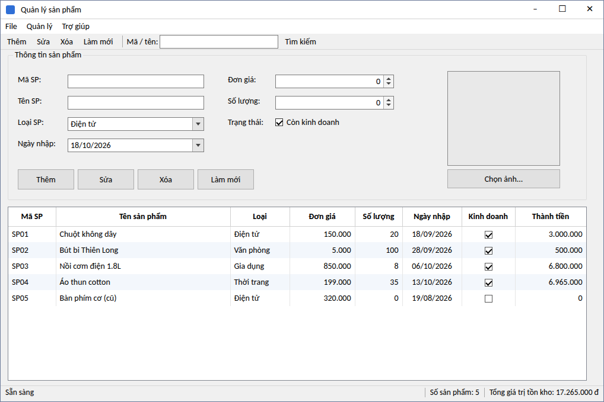
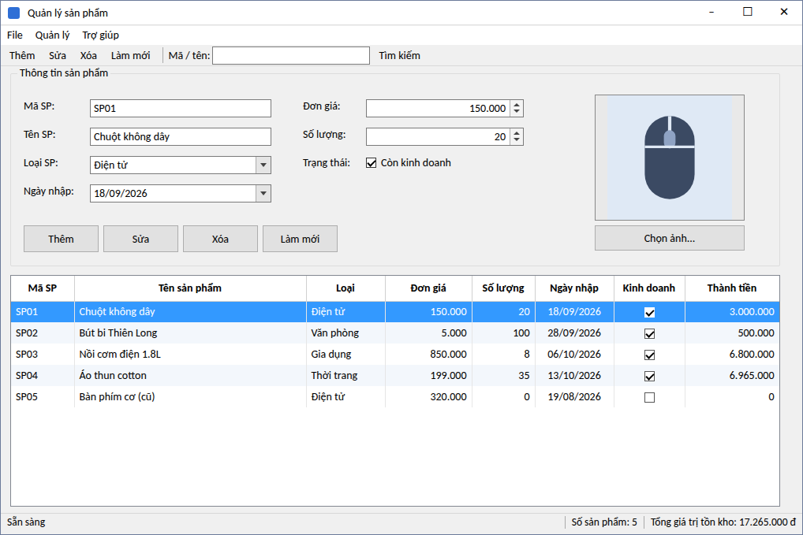
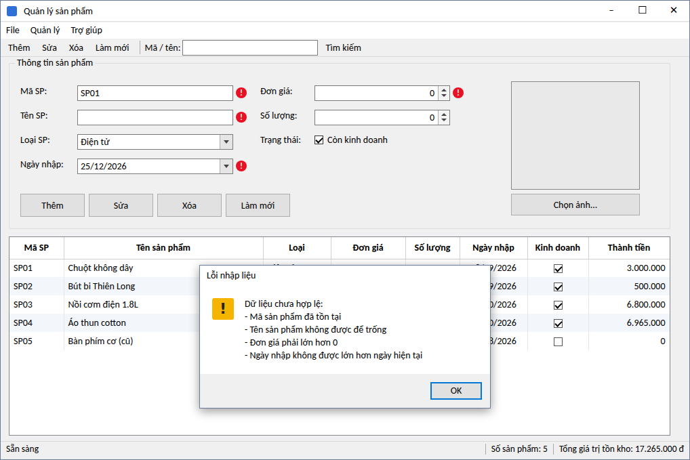
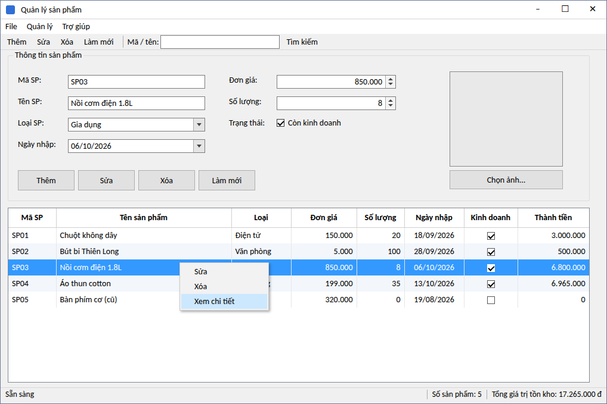
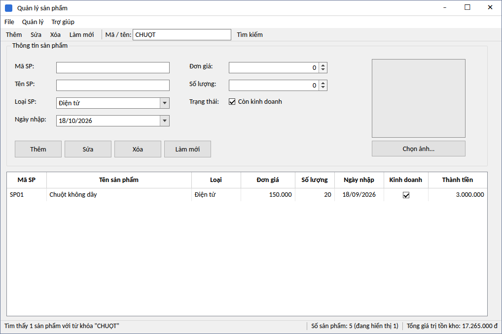
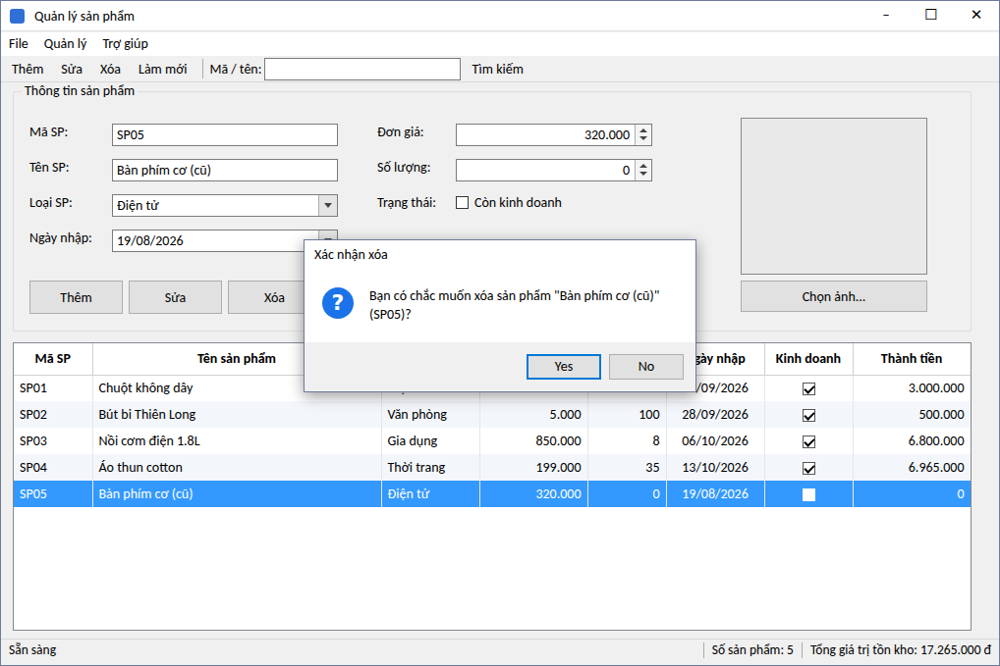

# LAB 06 
## 2611COMP101904-Lap-trinh-Windows
## Bài Lab: Lab 06 
## Họ tên sinh viên: Hoàng Minh Nhật
## MSSV: 51.01.104.066
## Nhóm 5

Ứng dụng Windows Forms quản lý danh sách sản phẩm của một cửa hàng. Dữ liệu lưu **trong bộ nhớ** bằng
`BindingList<Product>` + `BindingSource` (chưa kết nối SQL Server).

> **Lưu ý về hình ảnh:** các ảnh trong thư mục `docs/images` là ảnh **minh họa giao diện** dựng theo đúng kích thước,
> vị trí control trong `FrmProduct.Designer.cs` và dữ liệu mẫu trong code. Sau khi chạy chương trình trên máy,
> hãy chụp lại màn hình thật (Win + Shift + S) và thay các file ảnh cùng tên để nộp bài.

---

## 1. Cách chạy

**Yêu cầu:** Windows, Visual Studio 2022 (workload *.NET desktop development*) hoặc .NET 8 SDK.

- **Visual Studio:** mở file `ProductManager.csproj` → nhấn `F5`.
- **Dòng lệnh:**
  ```bash
  dotnet run --project ProductManager.csproj
  ```

## 2. Cấu trúc thư mục

```
ProductManager/
├── ProductManager.csproj
├── Program.cs                  # Điểm khởi chạy
├── Models/
│   └── Product.cs              # Class Product (dữ liệu)
├── FrmProduct.Designer.cs      # Giao diện (control, bố cục, sự kiện)
├── FrmProduct.cs               # Xử lý logic
├── README.md
└── docs/images/                # Ảnh minh họa dùng trong README
```

## 3. Giao diện

### 3.1 Màn hình chính khi khởi động



| Khu vực | Control | Mô tả |
|---|---|---|
| Thanh menu | `menuStrip1` | 3 nhóm: **File**, **Quản lý**, **Trợ giúp** |
| Thanh công cụ | `toolStrip1` | Nút Thêm, Sửa, Xóa, Làm mới; ô nhập `txtTimKiem` và nút Tìm kiếm |
| Nhóm nhập liệu | `grpThongTin` | Chứa toàn bộ control nhập thông tin sản phẩm |
| Danh sách | `dgvProducts` | `ReadOnly = true`, `FullRowSelect`, `MultiSelect = false` |
| Thanh trạng thái | `statusStrip1` | `lblStatus` (thao tác), `lblCount` (số lượng), `lblTongTon` (tổng giá trị tồn kho) |
| Menu chuột phải | `ctmGrid` | Sửa, Xóa, Xem chi tiết |

### 3.2 Tên các control nhập liệu

| Trường dữ liệu | Control | Ghi chú |
|---|---|---|
| MaSP | `txtMaSP` | Không rỗng, không trùng (không phân biệt hoa/thường) |
| TenSP | `txtTenSP` | Không rỗng |
| LoaiSP | `cboLoaiSP` | `DropDownList`: Điện tử, Văn phòng, Gia dụng, Thời trang |
| DonGia | `numDonGia` | Phải > 0 |
| SoLuong | `numSoLuong` | Phải ≥ 0 |
| NgayNhap | `dtpNgayNhap` | Không được lớn hơn ngày hiện tại |
| ConKinhDoanh | `chkConKinhDoanh` | Mặc định được tick |
| DuongDanAnh | `picSanPham` + `btnChonAnh` | Dùng `OpenFileDialog`, có thể để trống |

## 4. Chức năng

### 4.1 Chọn một dòng → dữ liệu hiện lên form (phục vụ Sửa)

Nhấn vào một dòng trên lưới (hoặc dùng phím mũi tên), thông tin sản phẩm và ảnh được đưa lên form qua hàm `LoadProductToForm`.
Sửa dữ liệu rồi nhấn **Sửa** để lưu.



### 4.2 Kiểm tra dữ liệu bằng ErrorProvider + MessageBox

Hàm `ValidateInput` kiểm tra tất cả ô cùng lúc: mỗi ô sai hiện biểu tượng lỗi màu đỏ (di chuột vào để đọc nội dung),
đồng thời hiện một `MessageBox` liệt kê toàn bộ lỗi và đưa con trỏ về ô sai đầu tiên.
Biểu tượng lỗi của một ô tự biến mất khi người dùng sửa lại ô đó.



### 4.3 Menu chuột phải trên DataGridView

Nhấn chuột phải vào một dòng: dòng đó được chọn trước, sau đó hiện menu **Sửa / Xóa / Xem chi tiết**.
Nhấn đúp vào một dòng cũng mở hộp thoại chi tiết.



### 4.4 Tìm kiếm theo mã hoặc tên

Nhập từ khóa vào ô **Mã / tên** trên thanh công cụ rồi nhấn `Enter` hoặc nút **Tìm kiếm**.
Không phân biệt chữ hoa/thường (ví dụ `CHUỘT` vẫn tìm ra "Chuột không dây"). Thanh trạng thái hiển thị số kết quả.
Sửa/Xóa vẫn hoạt động đúng trên danh sách đã lọc.



### 4.5 Xác nhận trước khi xóa

Nhấn **Xóa** (nút, menu, toolbar, menu chuột phải hoặc phím `Delete` trên lưới) sẽ hiện hộp thoại xác nhận.
Nút mặc định là **No** để tránh xóa nhầm.



### 4.6 Các chức năng còn lại

| Chức năng | Cách thực hiện |
|---|---|
| **Load form** | Nạp 4 loại sản phẩm vào `cboLoaiSP`, thêm 5 sản phẩm mẫu, gán `BindingSource` cho `dgvProducts` |
| **Thêm** | `ValidateInput` → thêm vào `BindingList` → xóa ô tìm kiếm, hiển thị lại toàn bộ → cuộn tới dòng mới |
| **Sửa** | Cập nhật sản phẩm đang chọn; kiểm tra trùng mã nhưng bỏ qua chính sản phẩm đó |
| **Làm mới** | Xóa nội dung nhập, xóa lỗi ErrorProvider, xóa từ khóa tìm kiếm, hiển thị lại toàn bộ dữ liệu |
| **Chọn ảnh** | `OpenFileDialog` (jpg, jpeg, png, bmp, gif); ảnh đọc qua stream nên không bị khóa file |
| **StatusStrip** | Hàm `UpdateStatus` được gọi sau mỗi thao tác: cập nhật thông báo, số sản phẩm, tổng giá trị tồn kho |
| **Chưa chọn dòng** | Nhấn Sửa / Xóa / Xem chi tiết khi chưa chọn dòng chỉ hiện thông báo nhắc, không gây lỗi |

### 4.7 Phím tắt

| Phím | Chức năng |
|---|---|
| `Ctrl + N` | Thêm sản phẩm |
| `Ctrl + E` | Sửa (lưu thay đổi) |
| `Ctrl + D` | Xóa |
| `Ctrl + F` | Chuyển con trỏ tới ô tìm kiếm |
| `F5` | Làm mới |
| `Ctrl + S` | Xuất danh sách ra file `.txt` |
| `Ctrl + Q` | Thoát |
| `F1` | Giới thiệu |
| `Delete` (khi đang ở lưới) | Xóa dòng đang chọn |
| `Enter` (trong ô tìm kiếm) | Thực hiện tìm kiếm |

## 5. Thiết kế mã nguồn

- **`Product`** chỉ chứa dữ liệu và thuộc tính tính toán `ThanhTien = DonGia * SoLuong`.
- **`products`** (`BindingList<Product>`) là danh sách gốc; **`productSource`** (`BindingSource`) là nguồn cho lưới.
  Khi tìm kiếm, `productSource` được trỏ sang một `BindingList` chứa kết quả lọc; khi làm mới thì trỏ lại `products`.
  Nhờ vậy `productSource.Current` và dòng được chọn luôn khớp nhau.
- Các hàm tách riêng theo yêu cầu đề bài:

| Hàm | Vai trò |
|---|---|
| `ValidateInput(editing)` | Kiểm tra dữ liệu, đặt/ xóa lỗi ErrorProvider |
| `ClearInput()` | Xóa nội dung nhập, bỏ lỗi, bỏ chọn dòng |
| `LoadProductToForm(p)` | Đưa dữ liệu một sản phẩm lên form |
| `UpdateStatus(message)` | Cập nhật StatusStrip |
| `ApplyFilter(keyword)` | Lọc/hiển thị lại danh sách |
| `GetSelectedProduct()` / `RequireSelectedProduct()` | Lấy sản phẩm đang chọn, báo nếu chưa chọn |

- Các nút Thêm/Sửa/Xóa/Làm mới ở **form, menu và toolbar dùng chung một hàm xử lý**
  (`btnThem_Click`, `btnSua_Click`, …) nên không bị lặp code.

## 6. Kiểm thử nhanh

| STT | Thao tác | Kết quả mong đợi |
|---|---|---|
| 1 | Để trống mã, nhấn Thêm | Biểu tượng lỗi tại `txtMaSP` + MessageBox |
| 2 | Nhập mã `sp01` (đã có `SP01`), nhấn Thêm | Báo "Mã sản phẩm đã tồn tại" |
| 3 | Để đơn giá = 0, nhấn Thêm | Báo "Đơn giá phải lớn hơn 0" |
| 4 | Chọn ngày nhập ở tương lai, nhấn Thêm | Báo lỗi ngày nhập |
| 5 | Vừa mở chương trình, nhấn Sửa hoặc Xóa | Hiện nhắc "Vui lòng chọn một sản phẩm…", không lỗi |
| 6 | Chọn dòng, nhấn Xóa → chọn Yes | Dòng bị xóa, số lượng trên StatusStrip giảm 1 |
| 7 | Tìm `chuot` / `CHUỘT` | Chỉ còn dòng "Chuột không dây" |
| 8 | Tìm kiếm rồi sửa một dòng trong kết quả | Đúng sản phẩm được cập nhật |
| 9 | Nhấn Làm mới sau khi tìm kiếm | Hiện đủ danh sách, form sạch, hết biểu tượng lỗi |
| 10 | Nhấn Chọn ảnh, chọn file `.png` | Ảnh hiện trong `picSanPham` |

## 7. Phần mở rộng đã làm

- Xuất danh sách ra file `.txt` bằng `SaveFileDialog` (menu **File → Xuất danh sách**).
- Tính **tổng giá trị tồn kho** và hiển thị trên StatusStrip.

Chưa làm: sắp xếp theo đơn giá/số lượng.
