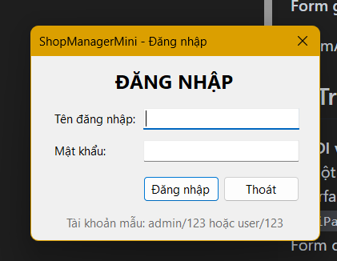
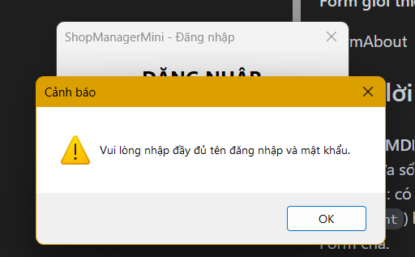
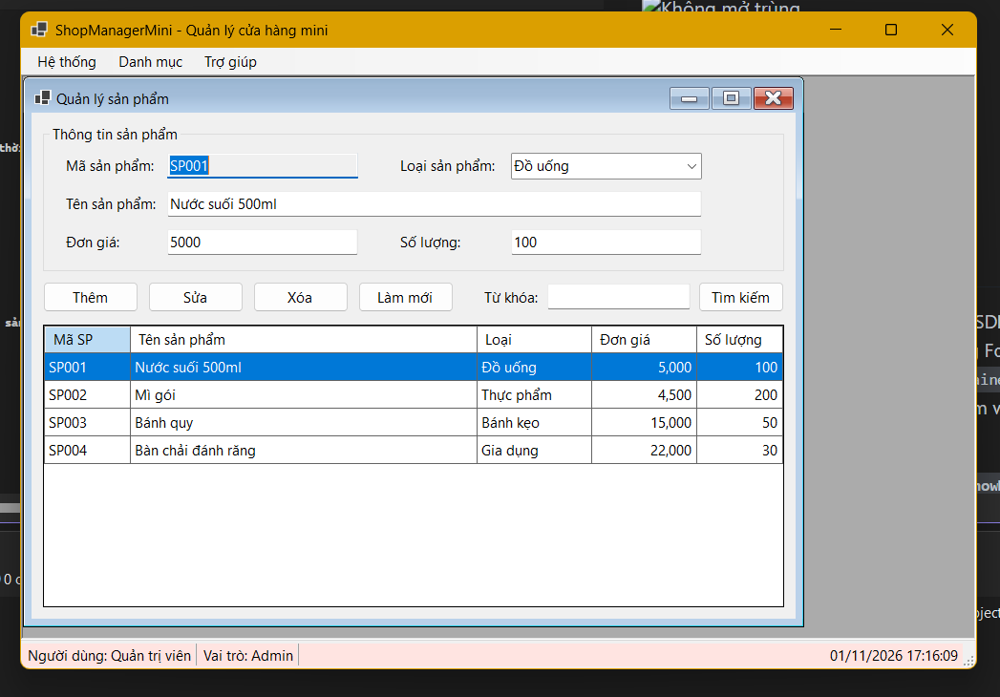
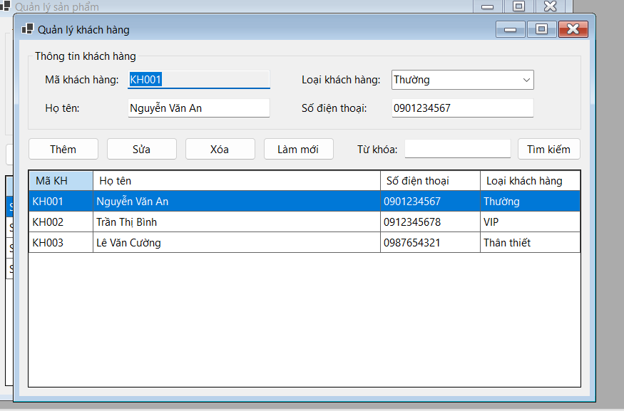
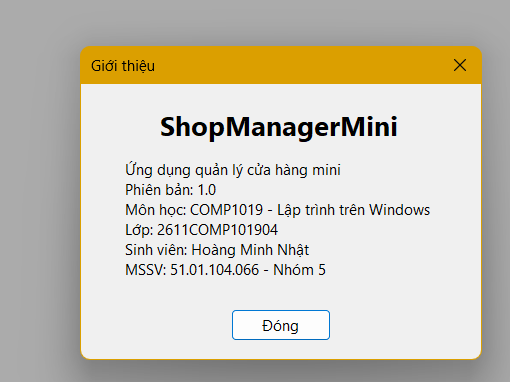

# LAB 07
## 2611COMP101904-Lap-trinh-Windows
## Bài Lab: Lab 07
## Họ tên sinh viên: Hoàng Minh Nhật
## MSSV: 51.01.104.066
## Nhóm 5

---

## 1. Giới thiệu

**ShopManagerMini** là ứng dụng WinForms quản lý cửa hàng mini gồm nhiều Form: đăng nhập, Form chính dạng MDI, quản lý sản phẩm, quản lý khách hàng và giới thiệu. Dữ liệu lưu trong bộ nhớ (`BindingList<T>`), chưa dùng SQL Server.


## 2. Cấu trúc project

```
ShopManagerMini
|-- Models:  User.cs, Product.cs, Customer.cs
|-- Forms:   FrmLogin, FrmMain, FrmProduct, FrmCustomer, FrmAbout
|-- Program.cs
```

## 3. Ảnh minh họa

**Form đăng nhập**



**Báo lỗi khi đăng nhập sai / bỏ trống**



**Quản lý sản phẩm (mở bên trong FrmMain)**



**Quản lý khách hàng**



**Form giới thiệu**




## 6. Trả lời câu hỏi

**1. SDI và MDI khác nhau như thế nào?**
SDI (Single Document Interface): mỗi Form là một cửa sổ độc lập, không nằm trong Form nào khác. MDI (Multiple Document Interface): có một Form cha (`IsMdiContainer = true`) chứa nhiều Form con (`MdiParent`) hiển thị bên trong vùng làm việc của Form cha, đóng/thu nhỏ theo Form cha.

**2. Vì sao Form đăng nhập nên dùng `ShowDialog()`?**
`ShowDialog()` mở Form dạng modal: chương trình dừng lại chờ người dùng đăng nhập xong, không cho thao tác Form khác, và trả về `DialogResult` để biết đăng nhập thành công (`OK`) hay không. Nhờ đó Form chính chỉ mở sau khi đăng nhập thành công.

**3. Dữ liệu user được truyền từ FrmLogin sang FrmMain bằng cách nào?**
Khi đăng nhập thành công, `FrmLogin` lưu user vào property `NguoiDung`. Trong `Program.cs`, sau khi `ShowDialog()` trả `OK`, đọc `login.NguoiDung` rồi truyền vào constructor `new FrmMain(login.NguoiDung)`. FrmMain dùng user này để hiển thị tên và vai trò trên StatusStrip.

**4. Nếu người dùng bấm menu sản phẩm nhiều lần, chương trình xử lý thế nào để không mở trùng Form?**
Hàm `MoFormCon<T>()` tìm Form cùng loại trong `MdiChildren` bằng `MdiChildren.OfType<T>().FirstOrDefault()`. Nếu đã có thì gọi `Activate()` (và khôi phục nếu đang thu nhỏ), nếu chưa có mới tạo Form mới.

**5. Khi nào nên dùng constructor, khi nào nên dùng property để truyền dữ liệu giữa các Form?**
- **Constructor**: dữ liệu bắt buộc, cần có ngay khi Form được tạo, ví dụ `FrmMain(User)`, `FrmProduct(danhSach)`.
- **Property**: dữ liệu tùy chọn hoặc cần đọc/ghi sau khi Form đã tạo, đặc biệt để lấy kết quả trả về từ Form con, ví dụ `FrmLogin.NguoiDung`.