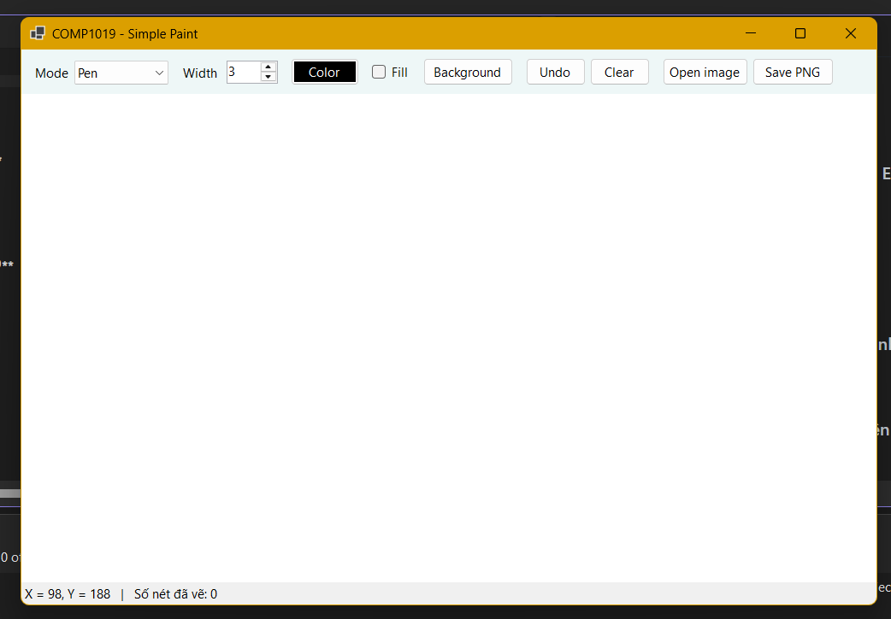
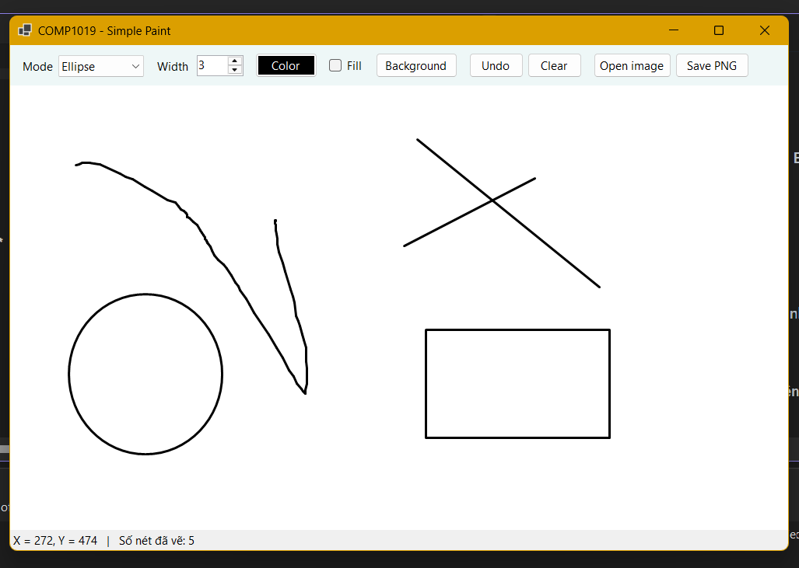
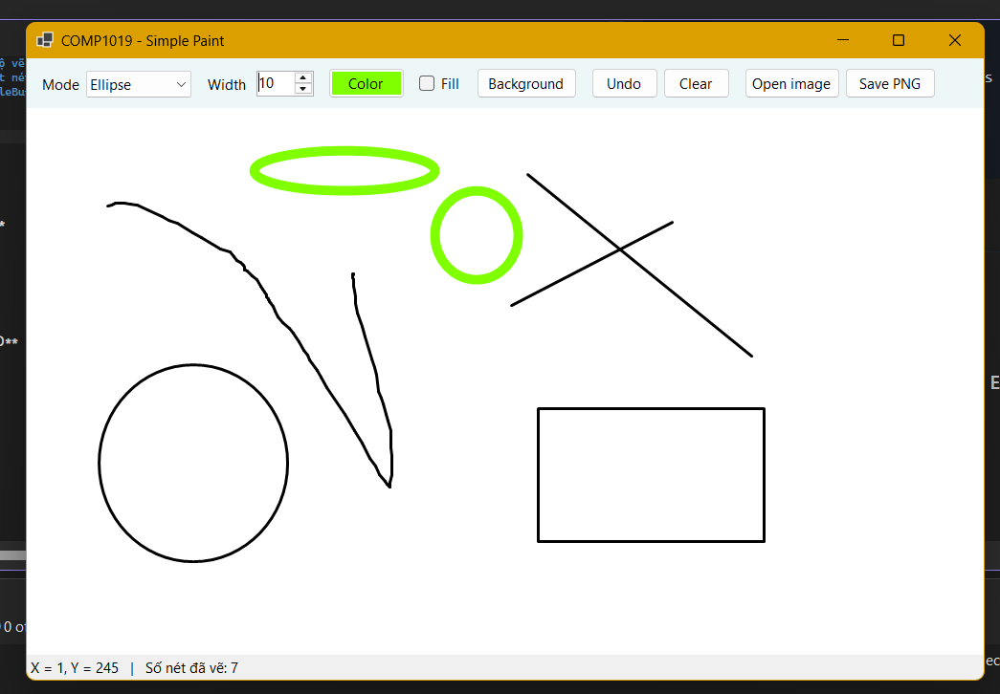
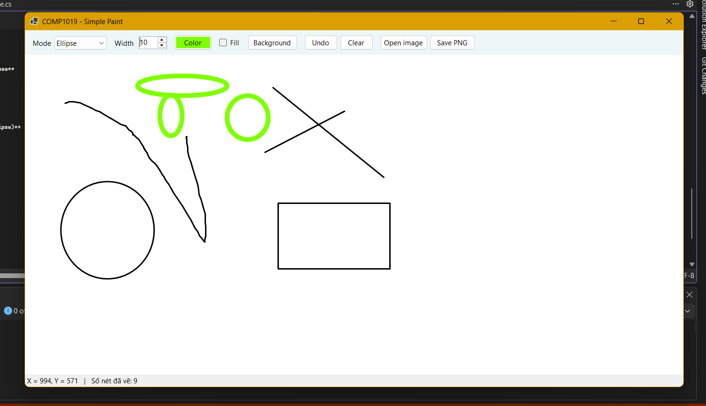
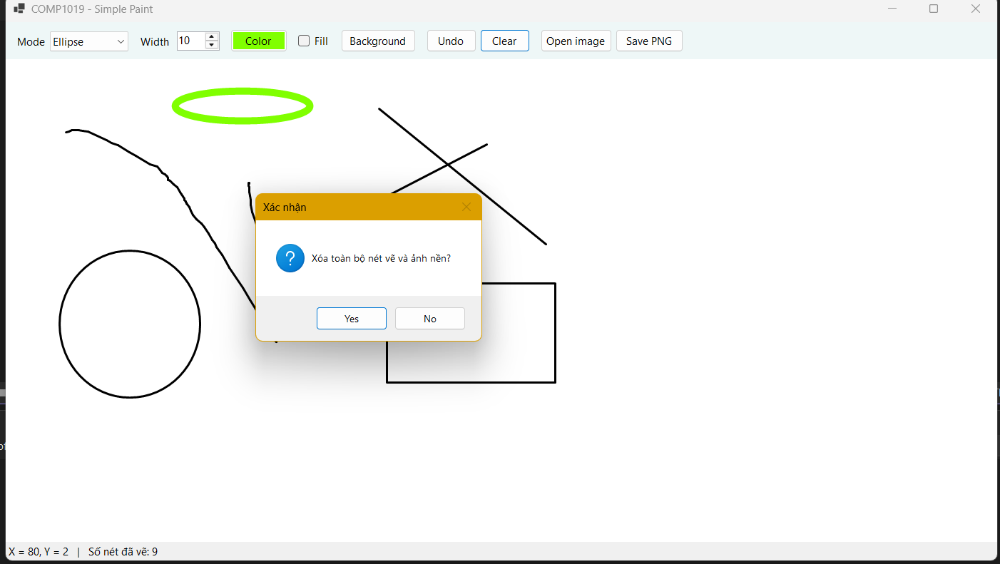
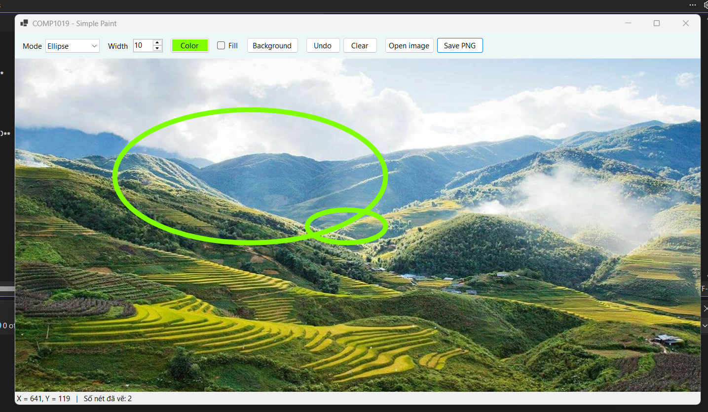

# LAB 8
## 2611COMP101904-Lap-trinh-Windows
## Bài Lab: Lab 8
## Họ tên sinh viên: Hoàng Minh Nhật
## MSSV: 51.01.104.066
## Nhóm 5

---

## 1. Giới thiệu

**Simple Paint** là ứng dụng vẽ đơn giản bằng WinForms và GDI+. Mỗi nét vẽ được lưu trong `List<DrawItem>` và vẽ lại trong sự kiện `Paint` của canvas, nên hình không bị mất khi resize Form hoặc bị che rồi hiện lại.

## 2. Chức năng

**Bắt buộc:** vẽ Pen / Line / Rectangle / Ellipse (kéo chuột theo mọi hướng), chọn màu (`ColorDialog`), chọn độ dày 1–20, Undo, Clear, hiển thị tọa độ chuột, nét vẽ không mất khi resize.

**Nâng cao:**
- Lưu vùng vẽ ra file **PNG** (nút Save PNG)
- Mở **ảnh nền** để vẽ đè lên (nút Open image)
- Phím tắt **Ctrl+Z** để Undo
- Chế độ **tô màu** hình chữ nhật / ellipse (ô Fill)
- Đổi **màu nền** canvas (nút Background)

## 3. Cấu trúc project

```
COMP1019_Lab08_SimplePaint
|-- Program.cs
|-- FrmPaint.cs, FrmPaint.Designer.cs   # Form chính, xử lý chuột, vẽ
|-- DrawMode.cs                         # enum chế độ vẽ
|-- DrawItem.cs                         # dữ liệu một nét vẽ
|-- DrawSurface.cs                      # Panel DoubleBuffered
```

## 4. Ảnh minh họa

**Giao diện khi mở chương trình**



**Vẽ thử 4 loại hình: Pen, Line, Rectangle, Ellipse**



**Chọn màu và độ dày nét**



**Kéo chuột theo nhiều hướng (hình chữ nhật, ellipse)**


**Hình sau khi resize Form vẫn còn nguyên**



**Undo / Clear**



**Chức năng nâng cao: tô màu, ảnh nền, lưu PNG**



