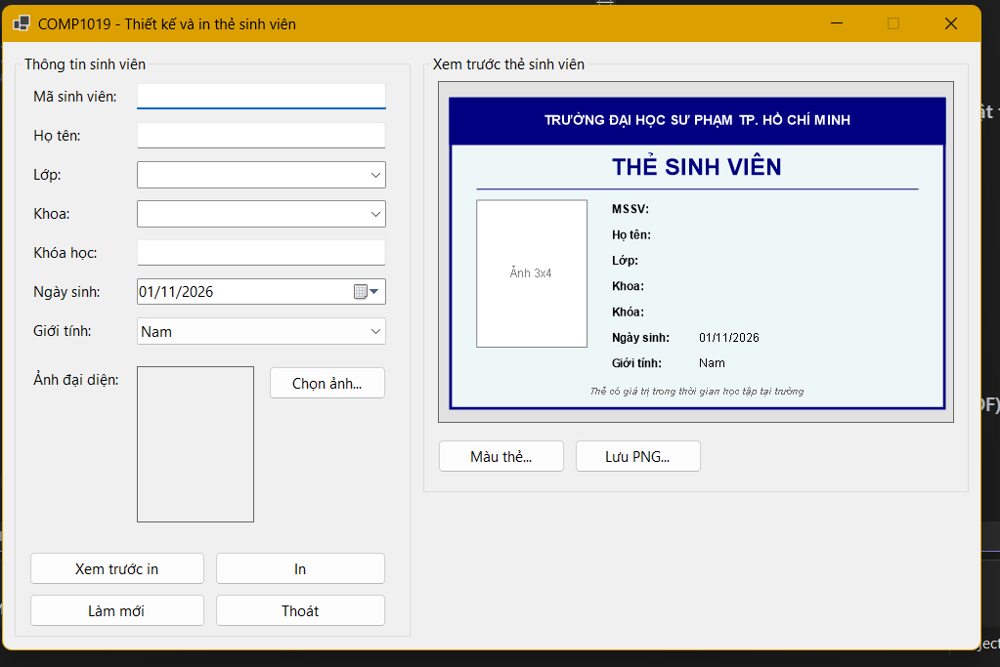
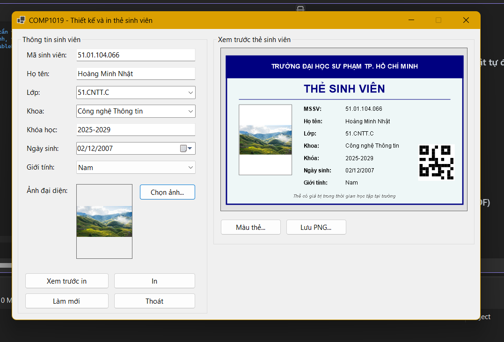
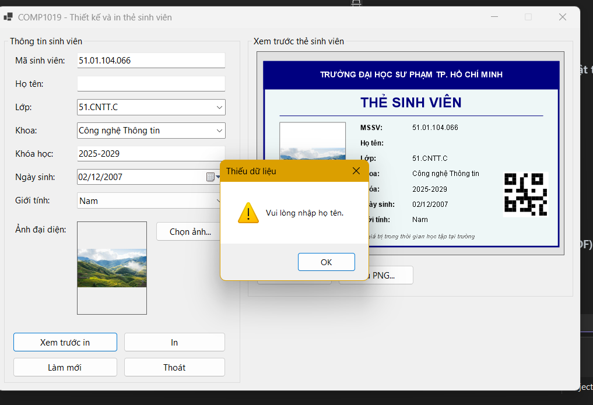
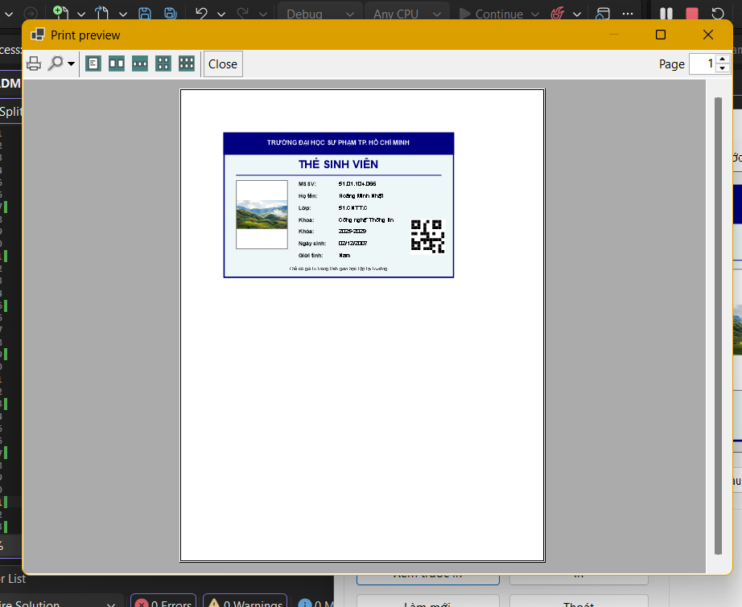
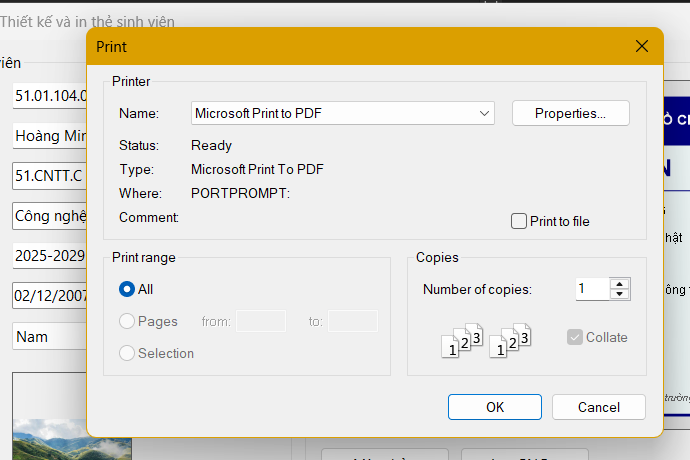
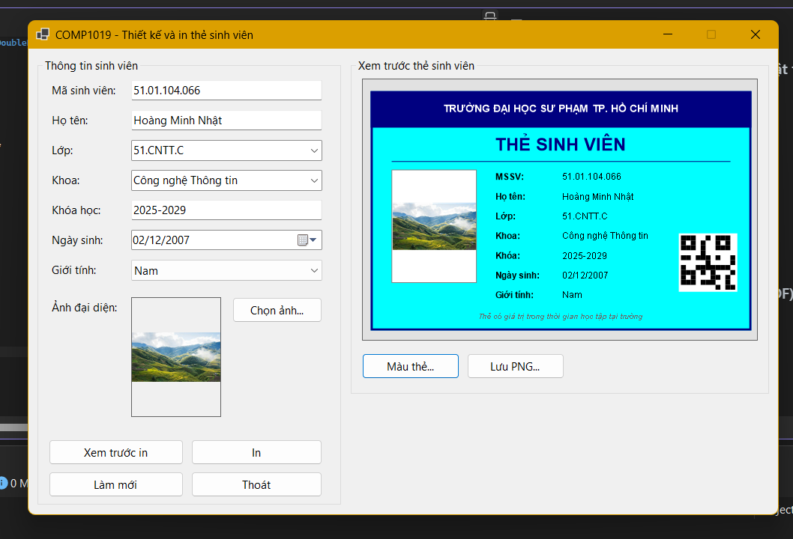

# LAB 09
## 2611COMP101904-Lap-trinh-Windows
## Bài Lab: Lab 09
## Họ tên sinh viên: Hoàng Minh Nhật
## MSSV: 51.01.104.066
## Nhóm 5

---

## 1. Giới thiệu

Ứng dụng WinForms **thiết kế và in thẻ sinh viên**: nhập thông tin, chọn ảnh đại diện, xem trước thẻ bằng GDI+ trên Panel, xem trước bản in (`PrintPreviewDialog`) và in (`PrintDocument` + `PrintDialog`). Preview, bản in và file PNG dùng chung một hàm vẽ `DrawStudentCard`, nên luôn giống nhau.

## 2. Chức năng

| Mã | Chức năng | Mô tả |
|----|-----------|-------|
| F1 | Chọn ảnh | Chỉ nhận JPG, JPEG, PNG, BMP; hiển thị dạng Zoom, không khóa file gốc |
| F2 | Preview thẻ | Panel tự vẽ lại bằng GDI+ mỗi khi dữ liệu thay đổi |
| F3 | Validation | Không cho xem trước in / in nếu thiếu mã sinh viên, họ tên hoặc ảnh |
| F4 | Xem trước in | Mở `PrintPreviewDialog` |
| F5 | In | Mở `PrintDialog`, in qua `PrintDocument` |
| F6 | Làm mới | Xóa dữ liệu, xóa ảnh, trả Form về trạng thái ban đầu |

**Mở rộng:** chọn màu nền thẻ, lưu thẻ ra PNG, mã QR giả lập vẽ bằng ô vuông (sinh từ mã sinh viên).

## 3. Cấu trúc project

```
StudentCardPrinter
|-- Program.cs
|-- StudentCardInfo.cs                    # Dữ liệu cần vẽ lên thẻ
|-- FrmStudentCard.cs, .Designer.cs       # Form chính, vẽ thẻ, in
|-- BufferedPanel.cs                      # Panel DoubleBuffered cho preview
```

## 4. Ảnh minh họa

**Form chính khi mở chương trình**



**Nhập đủ thông tin, preview thẻ cập nhật tự động**



**Báo lỗi khi thiếu dữ liệu bắt buộc**



**Print Preview**



**Kết quả in ra PDF (Microsoft Print to PDF)**



**Đổi màu thẻ / Lưu PNG**



