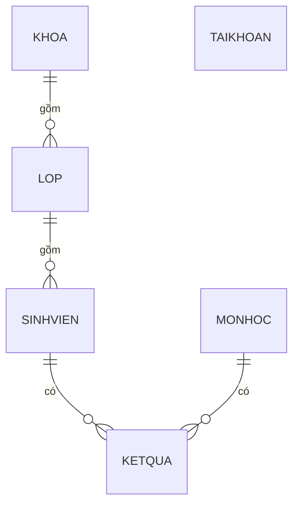
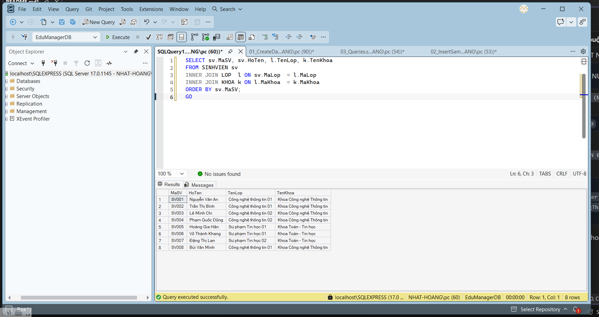
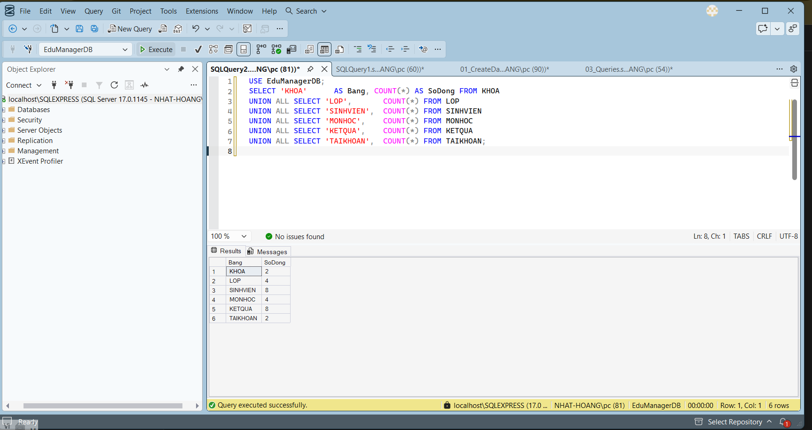
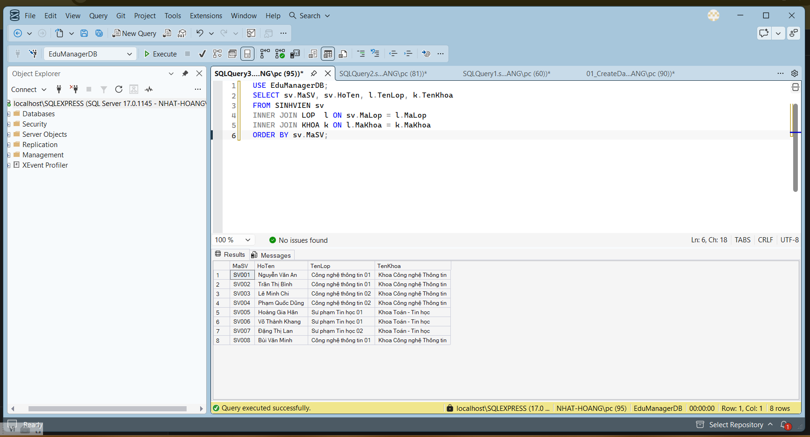
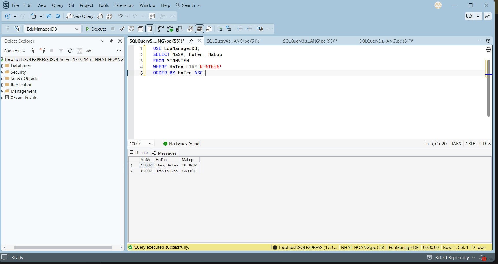
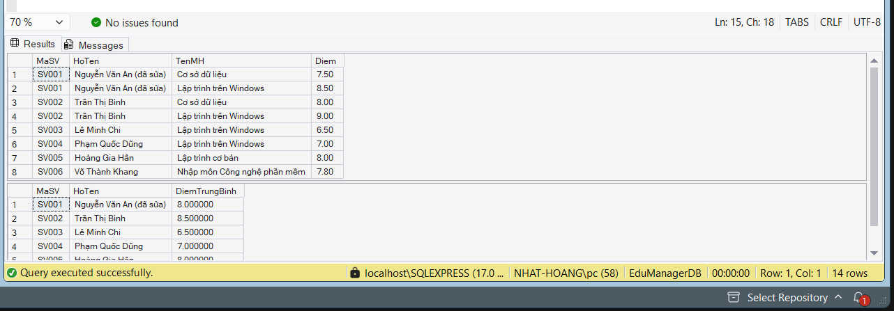
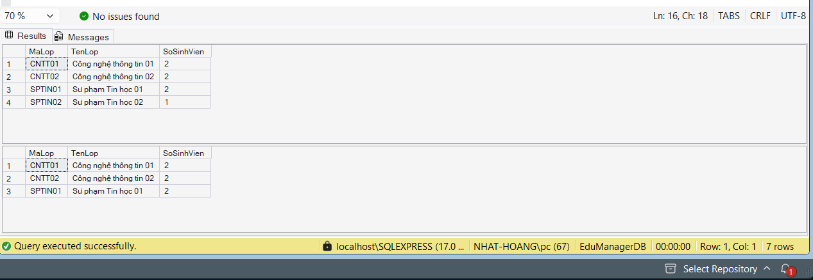
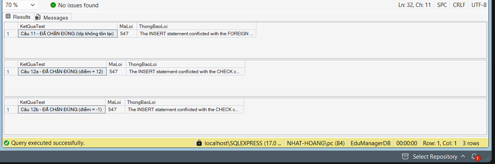

# LAB 10
## 2611COMP101904-Lap-trinh-Windows
## Bài Lab: Lab 10
## Họ tên sinh viên: Hoàng Minh Nhật
## MSSV: 51.01.104.066
## Nhóm 5

---

## 1. Giới thiệu

Thiết kế và cài đặt cơ sở dữ liệu **EduManagerDB** bằng SQL Server cho ứng dụng quản lý sinh viên: khoa, lớp, sinh viên, môn học, kết quả học tập và tài khoản đăng nhập.

## 2. Sơ đồ quan hệ

## 3. Cấu trúc bảng và ràng buộc

| Bảng | Khóa chính | Khóa ngoại | Ràng buộc chính |
|------|------------|------------|-----------------|
| KHOA | MaKhoa | - | TenKhoa NOT NULL |
| LOP | MaLop | MaKhoa → KHOA | TenLop NOT NULL |
| SINHVIEN | MaSV | MaLop → LOP | `GioiTinh IN (N'Nam', N'Nữ')` |
| MONHOC | MaMH | - | `SoTinChi > 0` |
| KETQUA | (MaSV, MaMH) | MaSV → SINHVIEN, MaMH → MONHOC | `Diem BETWEEN 0 AND 10` |
| TAIKHOAN | TenDangNhap | - | `VaiTro IN ('Admin','User')`, mặc định `User`; `TrangThai` mặc định 1 |

**Dữ liệu mẫu:** 2 khoa, 4 lớp, 8 sinh viên, 4 môn học, 8 kết quả, 2 tài khoản (`admin`/`123456`, `gv01`/`123456`).

## 4. Ảnh minh họa kết quả

**Object Explorer: đủ 8 bảng**

**Số dòng của từng bảng sau khi nhập dữ liệu mẫu**

**Câu 2: sinh viên kèm tên lớp và tên khoa**

**Câu 3: tìm sinh viên theo họ tên (LIKE)**

**Câu 5, 6: UPDATE và DELETE**

**Câu 7, 8: điểm từng môn và điểm trung bình**

**Câu 9, 10: thống kê số sinh viên theo lớp**

**Câu 11, 12: test lỗi khóa ngoại và lỗi điểm**

