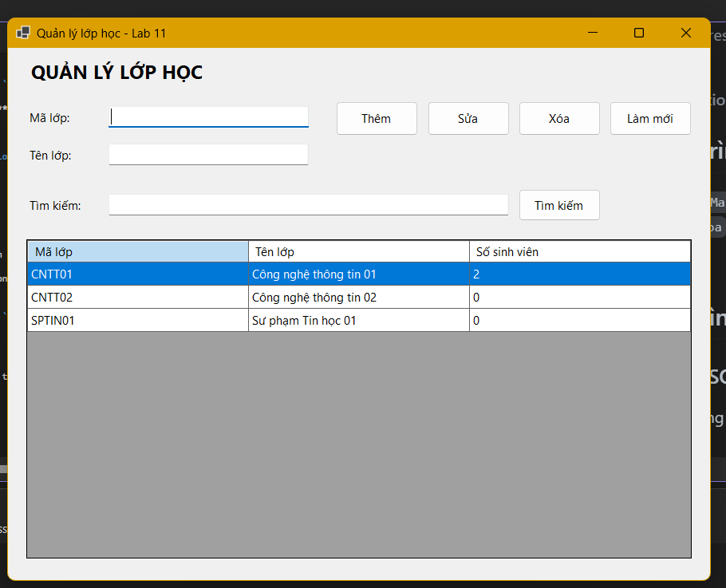
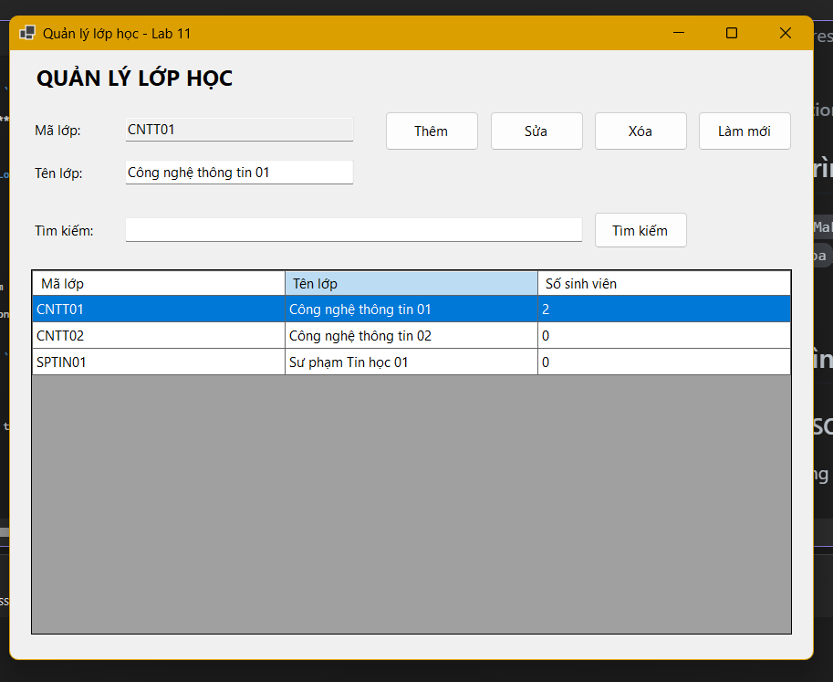
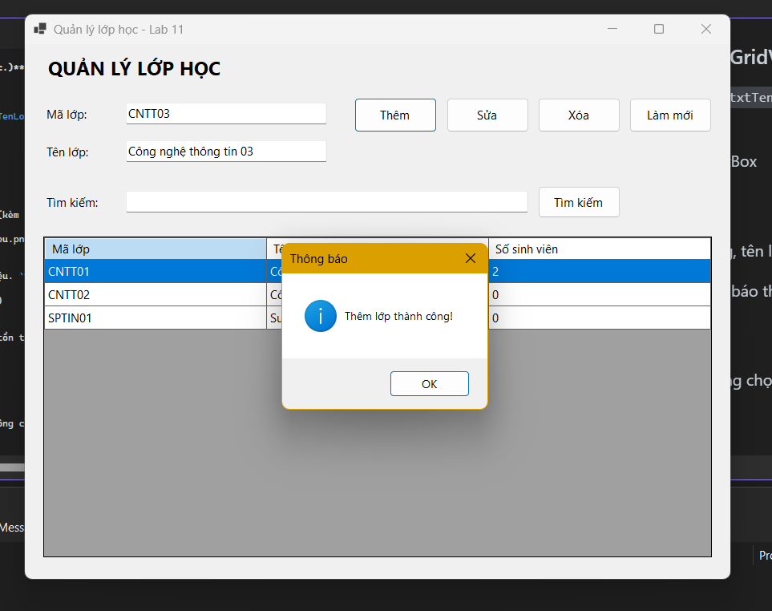
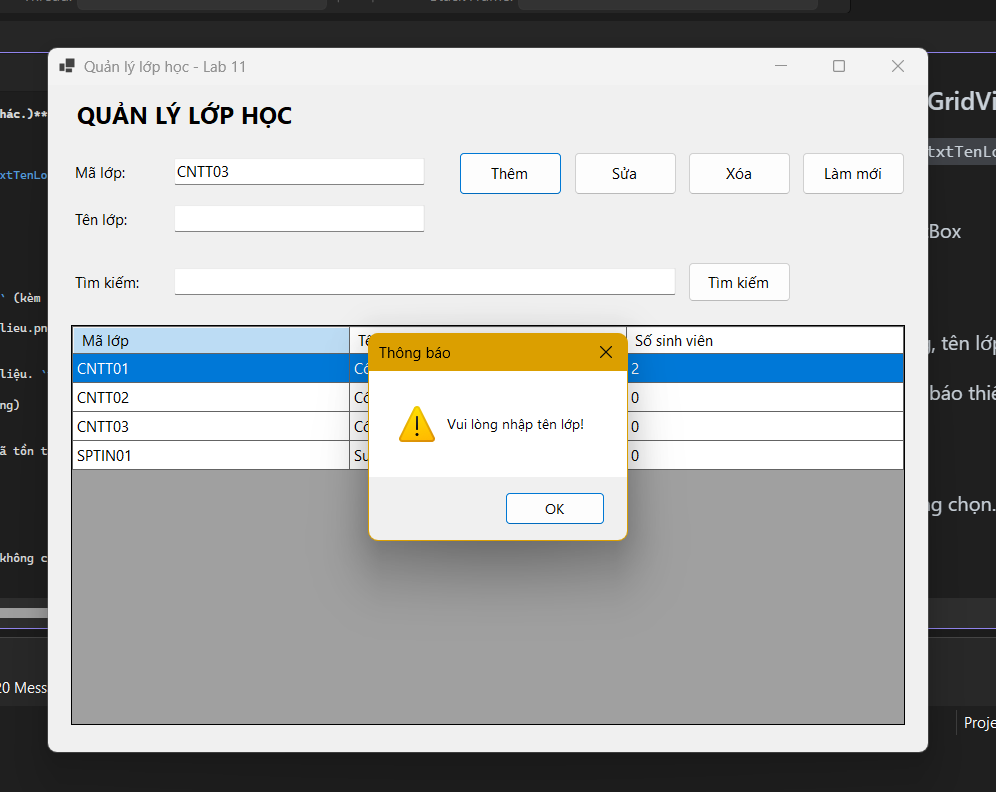
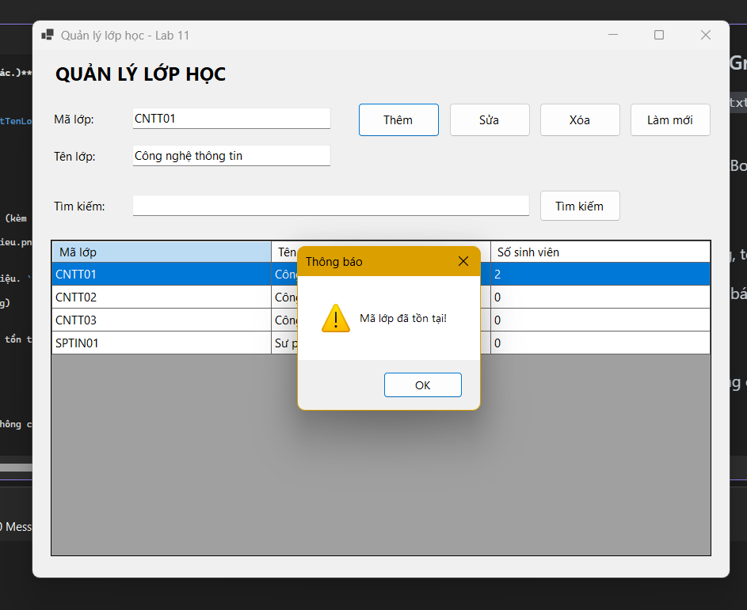
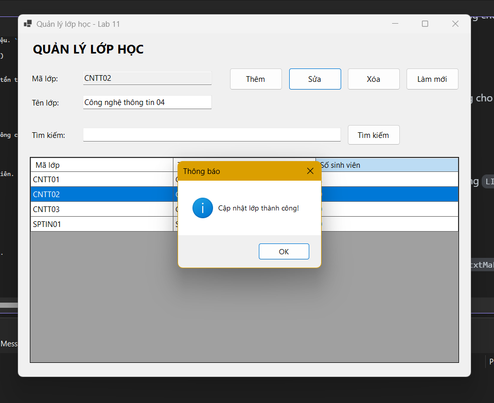
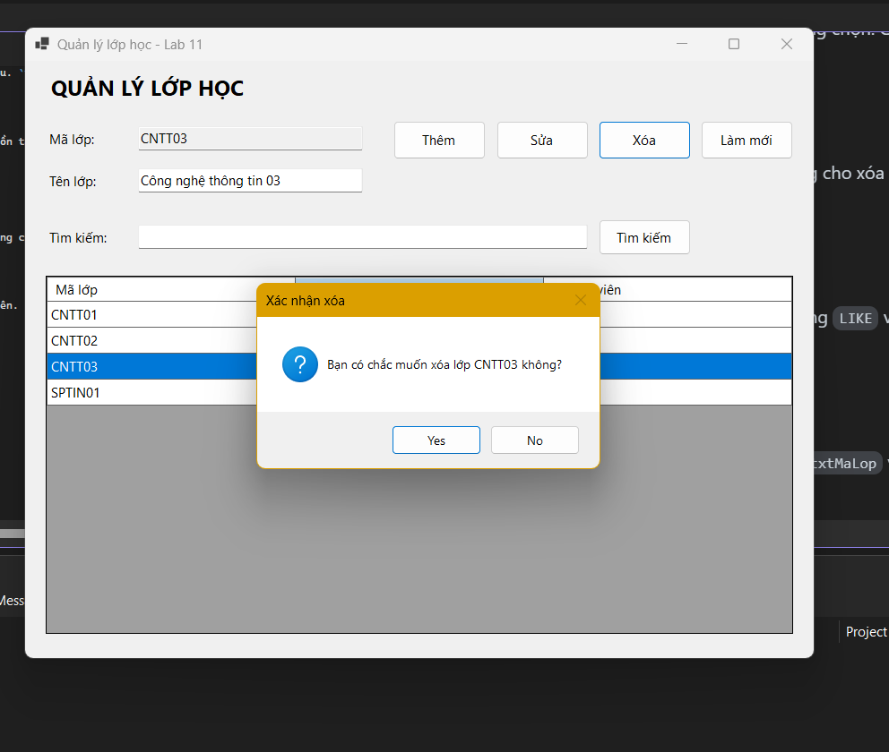
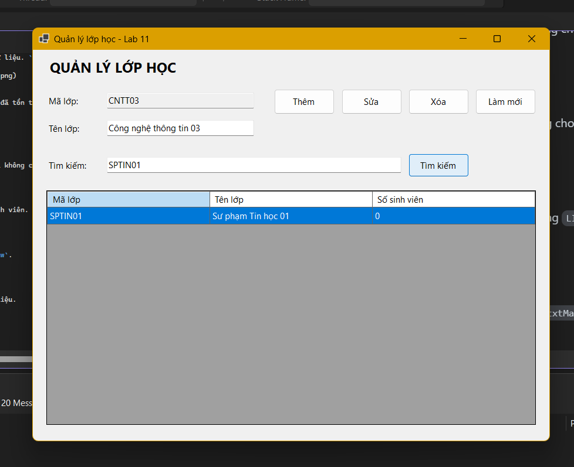
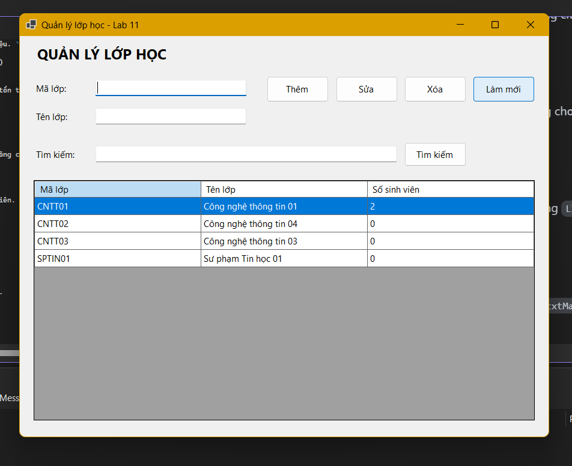

# LAB 11
## 2611COMP101904-Lap-trinh-Windows
## Bài Lab: Lab 11
## Họ tên sinh viên: Hoàng Minh Nhật
## MSSV: 51.01.104.066
## Nhóm 5

---

## 1. Giới thiệu

Ứng dụng **Windows Forms (C#)** quản lý lớp học, kết nối với **SQL Server** bằng **ADO.NET** (`Microsoft.Data.SqlClient`).
Dữ liệu được lưu trong database `EduManagerDB`, không lưu tạm bằng `List<T>`.

Chức năng chính: hiển thị danh sách lớp, thêm, sửa, xóa, tìm kiếm lớp học. Tất cả câu SQL đều dùng `SqlParameter`.

## 2. Cấu trúc thư mục

```
COMP1019_Lab11
|-- Program.cs
|-- FrmLop.cs
|-- FrmLop.Designer.cs
|-- COMP1019_Lab11.csproj
|-- EduManagerDB.sql      (script tạo database + dữ liệu mẫu)
|-- images/               (hình minh họa cho README)
|-- README.md
```

## 3. Connection string đang sử dụng trên máy cá nhân

```csharp
Data Source=.;Initial Catalog=EduManagerDB;Integrated Security=True;TrustServerCertificate=True
```

> Nếu máy dùng SQL Server Express thì đổi `Data Source=.` thành `Data Source=.\SQLEXPRESS`.
>
> **(Sửa lại đoạn này nếu connection string trên máy bạn khác.)**

## 4. Giao diện chương trình

Các control chính: `lblMaLop`, `txtMaLop`, `lblTenLop`, `txtTenLop`, `txtTimKiem`, `dgvLop`, `btnThem`, `btnSua`, `btnXoa`, `btnLamMoi`, `btnTimKiem`.




## 5. Các chức năng và hình minh họa

### F1. Load danh sách lớp từ SQL Server khi mở Form
Khi mở Form, chương trình tự động lấy dữ liệu từ bảng `LOP` (kèm số sinh viên của từng lớp) và hiển thị lên `dgvLop`.


### F2. Chọn dòng trong DataGridView
Click một dòng thì `txtMaLop` và `txtTenLop` được điền dữ liệu. `txtMaLop` bị khóa để tránh sửa khóa chính.



### F3. Thêm lớp
Không cho thêm nếu mã lớp rỗng, tên lớp rỗng hoặc mã lớp đã tồn tại.





### F4. Sửa lớp
Cập nhật tên lớp theo mã lớp đang chọn. Chưa chọn lớp thì không cho sửa.



### F5. Xóa lớp
Hỏi xác nhận trước khi xóa, không cho xóa lớp đang có sinh viên.



### F6. Tìm kiếm
Tìm theo mã lớp hoặc tên lớp bằng `LIKE` và parameter `@kw`.



### F7. Làm mới
Xóa nội dung TextBox, mở khóa `txtMaLop` và load lại dữ liệu.




