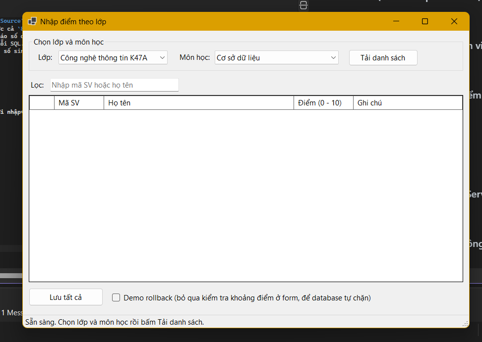
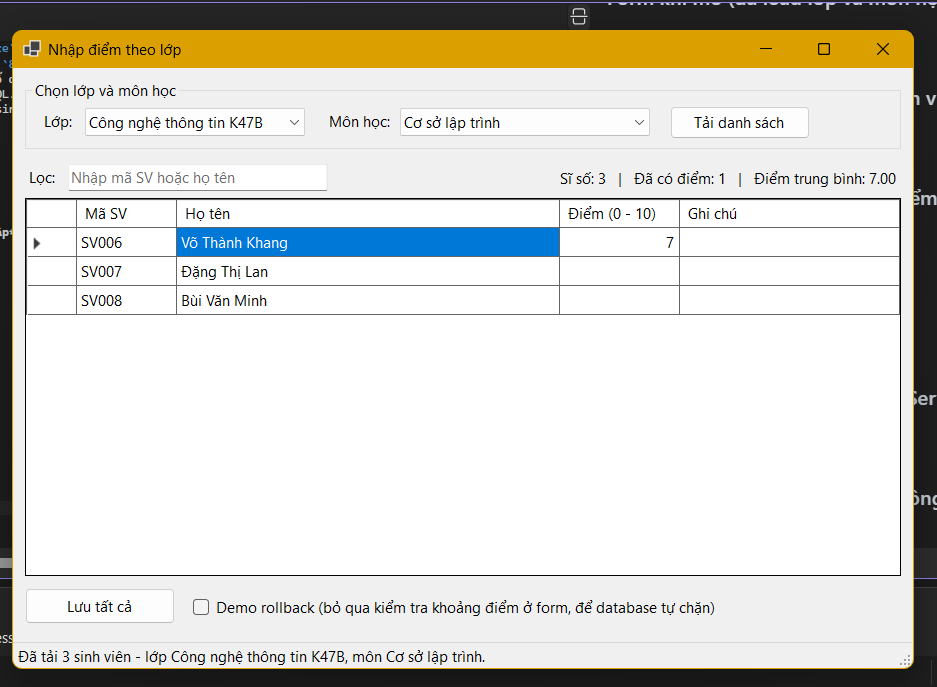
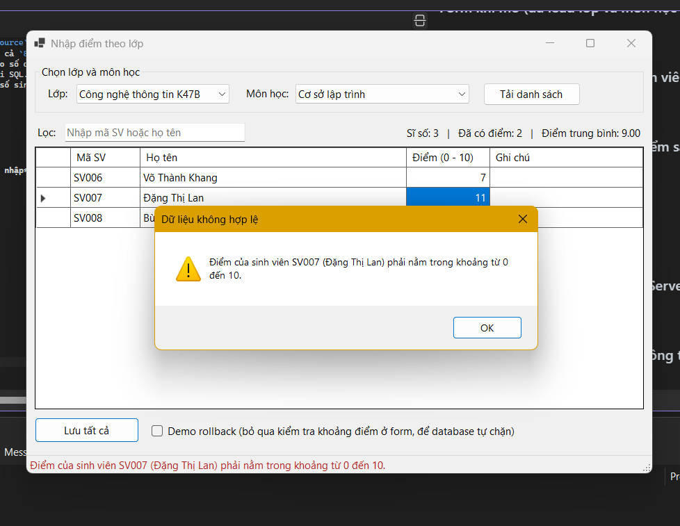
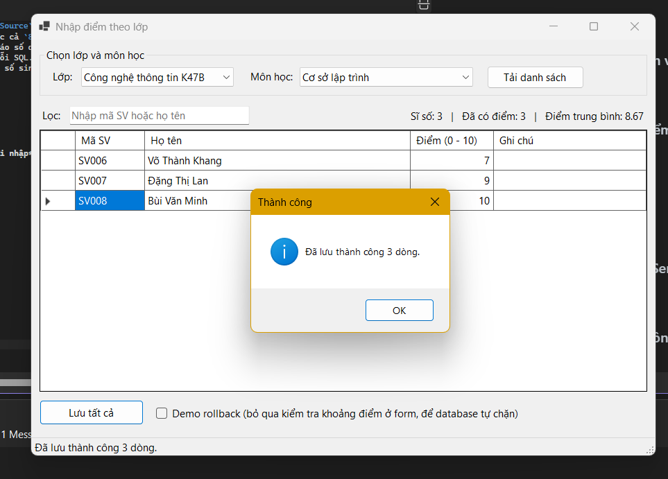

# LAB 12
## 2611COMP101904-Lap-trinh-Windows
## Bài Lab: Lab 12
## Họ tên sinh viên: Hoàng Minh Nhật
## MSSV: 51.01.104.066
## Nhóm 5

---

## 1. Giới thiệu

Module **Quản lý kết quả học tập** (WinForms + ADO.NET + SQL Server). Người dùng chọn lớp và môn học, hệ thống hiển thị danh sách sinh viên kèm điểm (nếu đã có), người dùng nhập hoặc sửa điểm rồi bấm **Lưu tất cả**. Toàn bộ điểm được lưu bằng **một transaction**: có dòng nào lỗi thì **rollback tất cả**.

## 2. Cách chạy

1. Mở SSMS, chạy file `Database/QLSinhVienLab12.sql` (tạo database, bảng, dữ liệu mẫu và 4 stored procedure).
2. Mở `DAL/Database.cs`, sửa `Data Source` trong `ConnectionString` cho đúng tên server của máy bạn (ví dụ `.`, `.\SQLEXPRESS`, `(localdb)\MSSQLLocalDB`).
3. Mở `QLSinhVienLab12.csproj` bằng Visual Studio 2022 (.NET 8), đợi NuGet tải `Microsoft.Data.SqlClient`, nhấn **F5**.

## 3. Cấu trúc project

```
QLSinhVienLab12
|-- Forms
|   |-- FrmNhapDiemTheoLop.cs, .Designer.cs   # Giao diện, data binding, validation
|-- DAL
|   |-- Database.cs                           # Chuỗi kết nối
|   |-- KetQuaDAL.cs                          # Gọi stored procedure, transaction
|-- Database
|   |-- QLSinhVienLab12.sql                   # Script tạo DB, dữ liệu mẫu, stored procedure
|-- Program.cs
```

## 4. Cơ sở dữ liệu và stored procedure

Bảng: `LOP`, `SINHVIEN`, `MONHOC`, `KETQUA` (khóa chính ghép `MaSV + MaMon`, `Diem` từ 0 đến 10, có khóa ngoại đầy đủ).

| Stored procedure | Chức năng |
|------------------|-----------|
| `sp_Lop_GetAll` | Lấy danh sách lớp |
| `sp_MonHoc_GetAll` | Lấy danh sách môn học |
| `sp_KetQua_GetByLopMon` | Lấy sinh viên theo lớp và môn, kèm điểm nếu đã có (LEFT JOIN, chưa có điểm thì để trống) |
| `sp_KetQua_Save` | Đã có điểm thì UPDATE, chưa có thì INSERT |


## 5. Chức năng

- Load lớp và môn học vào ComboBox bằng data binding (`DisplayMember`, `ValueMember`).
- Tải danh sách sinh viên lên `DataGridView` qua `BindingSource`; chỉ cột **Điểm** và **Ghi chú** được sửa.
- Validation: điểm không được trống, phải là số (nhập được cả `8.5` và `8,5`), nằm trong khoảng 0 đến 10.
- Lưu tất cả bằng transaction: thành công thì commit và báo số dòng đã lưu; lỗi thì rollback và báo lỗi.
- Gọi stored procedure bằng `SqlParameter`, không nối chuỗi SQL.
- **Mở rộng:** ô lọc theo mã SV / họ tên, thống kê sĩ số, số sinh viên đã có điểm, điểm trung bình; cảnh báo khi có thay đổi chưa lưu mà tải danh sách khác.

## 6. Ảnh minh họa

**Form khi mở (đã load lớp và môn học vào ComboBox)**



**Form trước khi lưu: danh sách sinh viên đã tải, điểm mới nhập**



**Báo lỗi khi để trống hoặc nhập điểm sai**



**Form sau khi lưu thành công**




