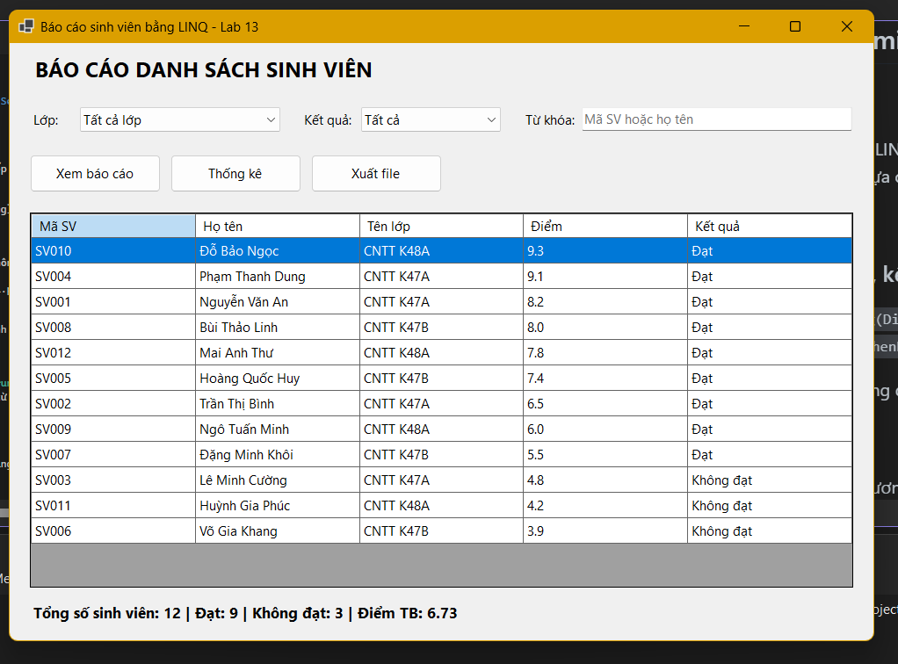
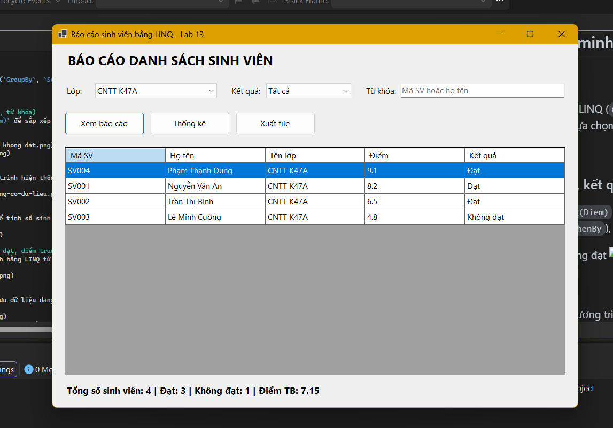
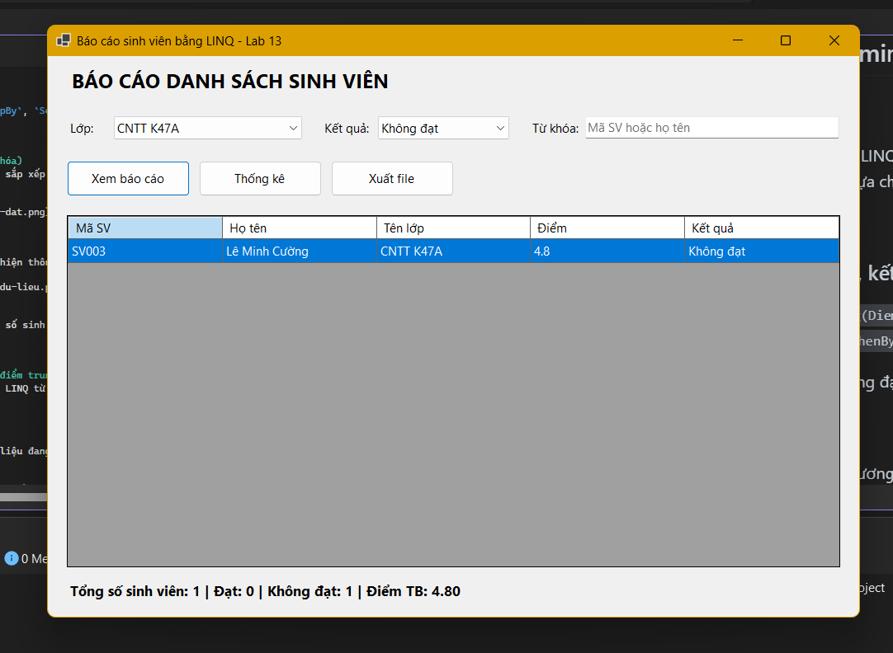
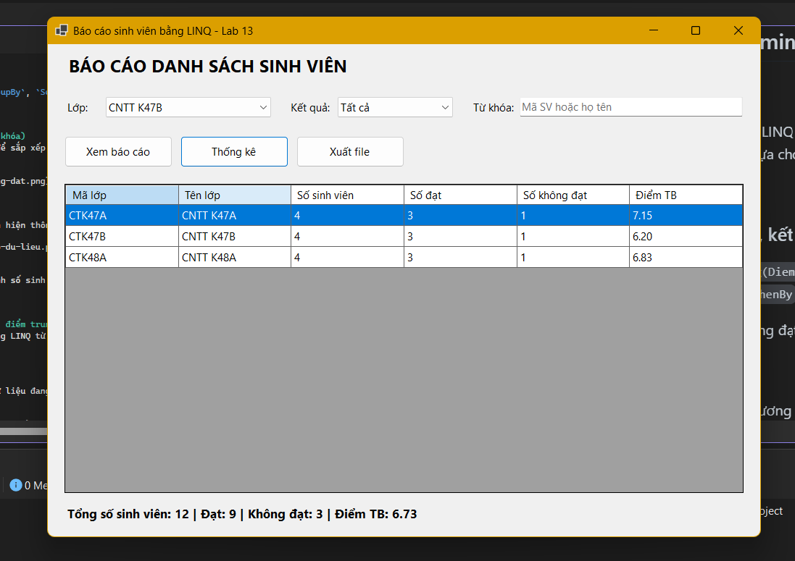
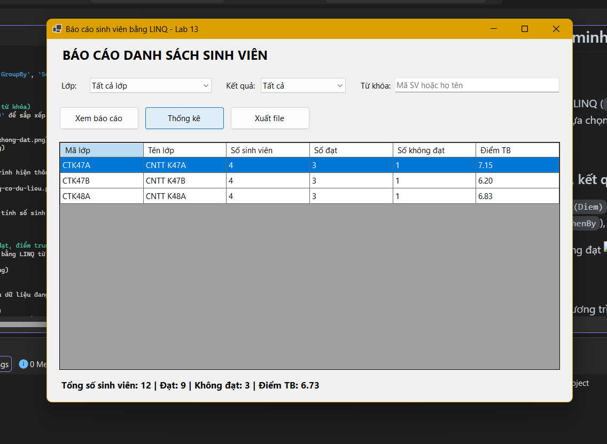
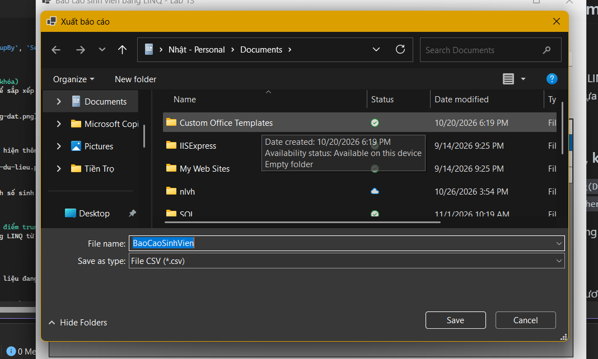
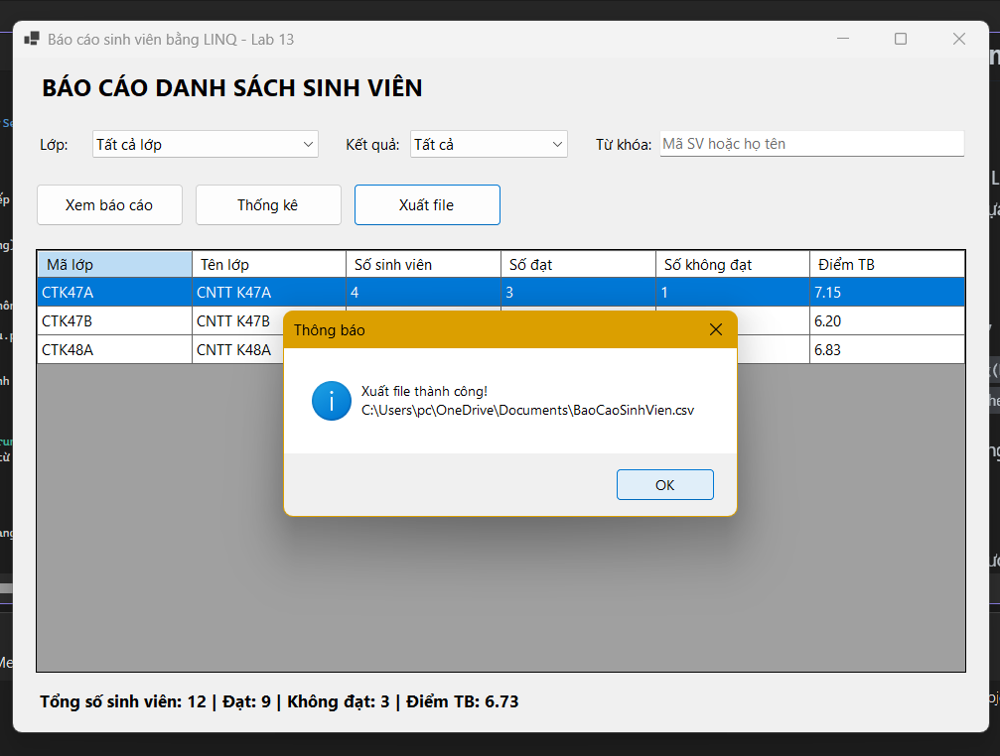

# LAB 15
## 2611COMP101904-Lap-trinh-Windows
## Bài Lab: Lab 15
## Họ tên sinh viên: Hoàng Minh Nhật
## MSSV: 51.01.104.066
## Nhóm 5

---

## 1. Giới thiệu

Module **Báo cáo danh sách sinh viên theo lớp** viết bằng **C# Windows Forms**, dùng **LINQ** để lọc, sắp xếp, nhóm và thống kê dữ liệu.
Người dùng chọn lớp, chọn kết quả học tập, nhập từ khóa rồi bấm **Xem báo cáo**. Kết quả có thể xuất ra file **CSV** hoặc **TXT**.

## 2. Công nghệ sử dụng

- Visual Studio 2022, .NET 8 (Windows Forms)
- LINQ (`Where`, `OrderByDescending`, `ThenBy`, `Select`, `GroupBy`, `Count`, `Average`)
- `DataGridView`, `SaveFileDialog`

## 3. Cấu trúc thư mục

```
StudentReportDemo
|-- Models
|   |-- SinhVien.cs            (model SinhVien, KetQua là thuộc tính chỉ đọc)
|   |-- CacLopHoTro.cs         (LopItem, DongBaoCao, ThongKeLop)
|-- Forms
|   |-- FrmBaoCaoSinhVien.cs
|   |-- FrmBaoCaoSinhVien.Designer.cs
|-- Program.cs
|-- StudentReportDemo.csproj
|-- BaoCao/                    (file CSV/TXT đã xuất)
|-- images/                    (hình minh họa cho README)
|-- README.md
```

## 4. Dữ liệu mẫu

12 sinh viên thuộc 3 lớp: **CNTT K47A**, **CNTT K47B**, **CNTT K48A** (mỗi lớp 4 sinh viên).
`KetQua` = "Đạt" nếu `Diem >= 5`, ngược lại là "Không đạt".

## 5. Giao diện chương trình

Các control chính: `cboLop`, `cboKetQua`, `txtTuKhoa`, `btnXemBaoCao`, `btnThongKe`, `btnXuatFile`, `dgvBaoCao`, `lblThongKe`.



## 6. Các chức năng và hình minh họa

### 6.1. Load dữ liệu khi mở Form
`cboLop` được load danh sách lớp bằng LINQ (`GroupBy`, `Select`, `OrderBy`), có thêm lựa chọn "Tất cả lớp". `cboKetQua` có 3 lựa chọn: Tất cả, Đạt, Không đạt.


### 6.2. Xem báo cáo (lọc theo lớp, kết quả, từ khóa)
Dùng `Where` để lọc, `OrderByDescending(Diem)` để sắp xếp giảm dần theo điểm (cùng điểm thì xếp theo họ tên bằng `ThenBy`), `Select` để chọn các cột hiển thị.




### 6.3. Thống kê theo lớp
Dùng `GroupBy` kết hợp `Count`, `Average` để tính số sinh viên, số đạt, số không đạt và điểm trung bình từng lớp.



### 6.4. Hiển thị tổng số, số đạt, số không đạt, điểm trung bình
Hiển thị ở `lblThongKe` phía dưới Form, tính bằng LINQ từ dữ liệu đang hiển thị.



### 6.5. Xuất file CSV / TXT
Bấm **Xuất file** để mở `SaveFileDialog`, lưu dữ liệu đang hiển thị ra file CSV hoặc TXT (UTF-8, mở bằng Excel không lỗi tiếng Việt). Có xử lý ngoại lệ khi ghi file.




