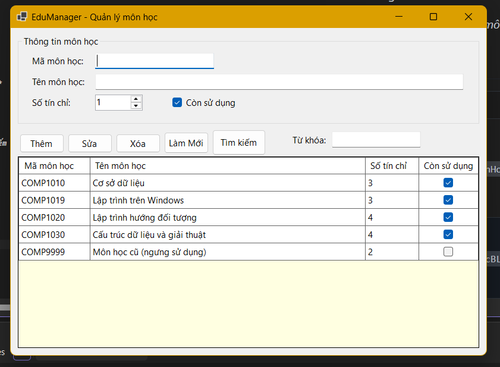
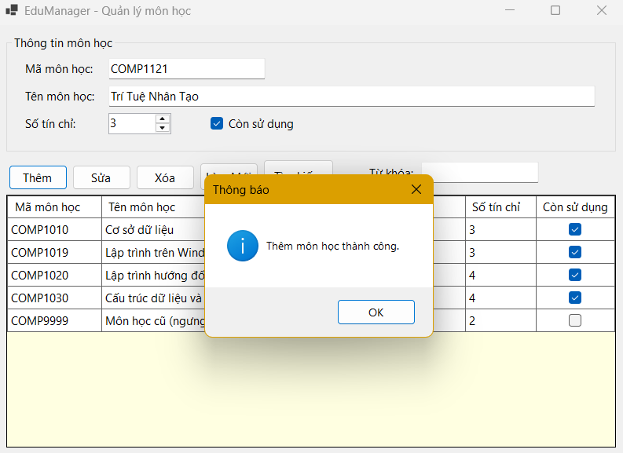
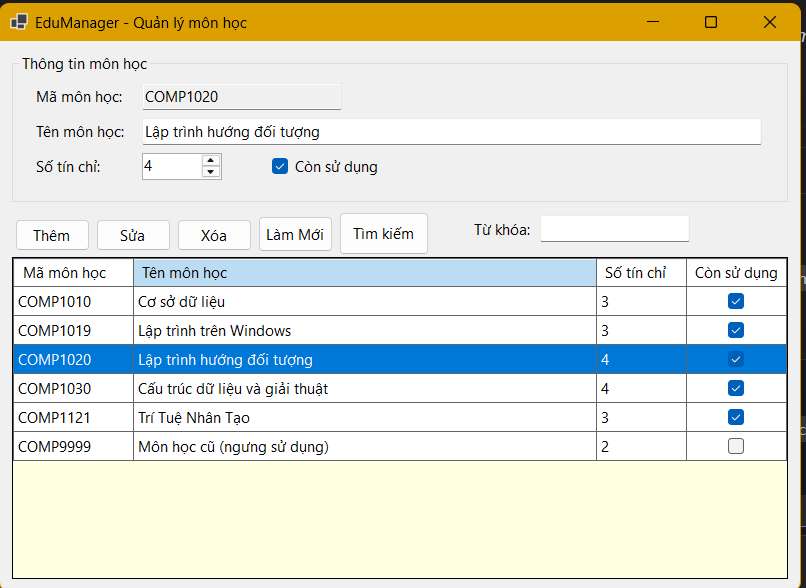
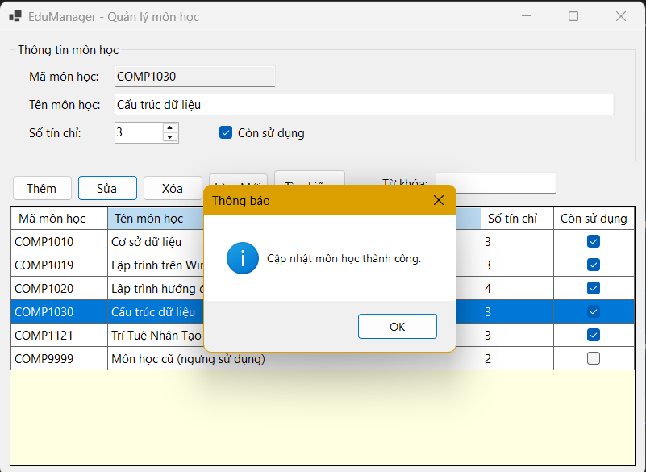
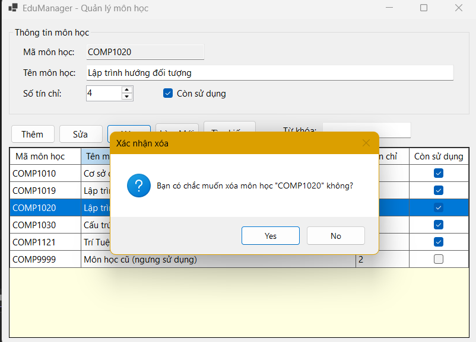
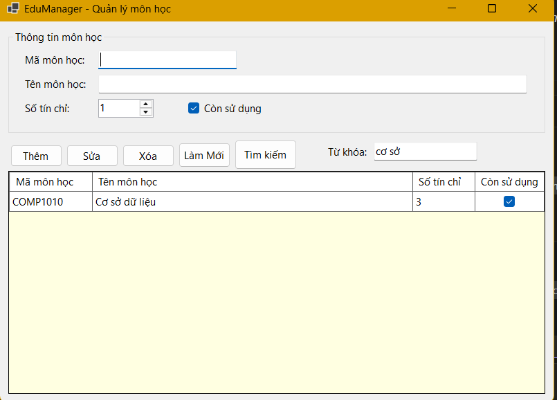
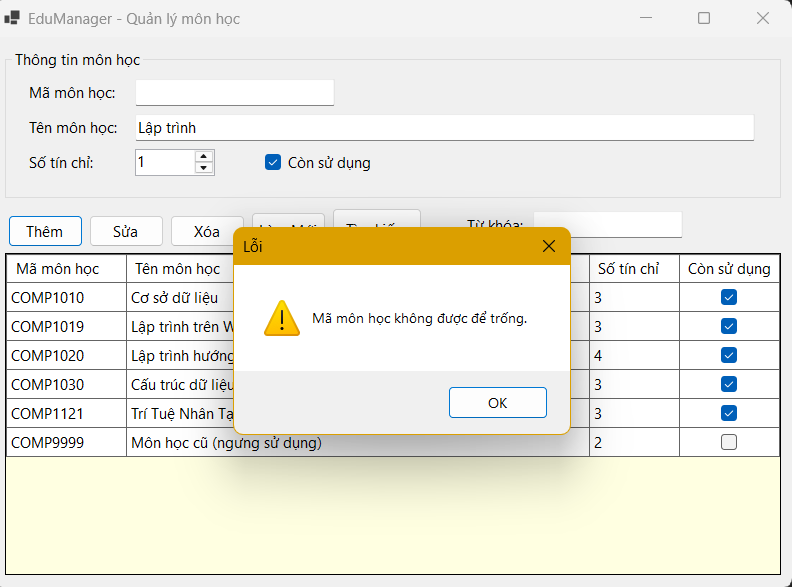
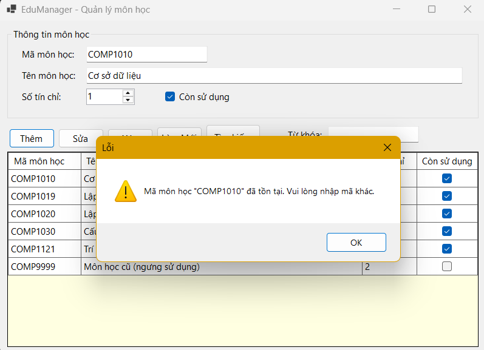

# LAB 05 - WINDOWS FORMS CƠ BẢN  
## 2611COMP101904-Lap-trinh-Windows
## Bài Lab: Lab 05 - Windows Forms Cơ Bản
## Họ tên sinh viên: Hoàng Minh Nhật
## MSSV: 51.01.104.066
## Nhóm 5


## 1. Giới thiệu

Module **Quản lý môn học** thuộc hệ thống EduManager, cho phép thêm, sửa, xóa, tìm kiếm và xem danh sách môn học lưu trong SQL Server thông qua giao diện Windows Forms. Dữ liệu được truy cập bằng **Entity Framework Core**, mã nguồn tổ chức theo **mô hình ba lớp**.

## 2. Cấu trúc thư mục

```
EduManager
|-- Models
|   |-- MonHoc.cs               # Entity
|-- Data
|   |-- EduManagerContext.cs    # DbContext
|-- DAL
|   |-- MonHocDAL.cs            # Truy cập CSDL bằng EF Core
|-- BLL
|   |-- MonHocBLL.cs            # Validation + nghiệp vụ
|-- GUI
|   |-- FrmMonHoc.cs            # Xử lý sự kiện giao diện
|   |-- FrmMonHoc.Designer.cs   # Thiết kế giao diện
|-- Database
|   |-- EduManagerDB.sql        # Script tạo DB, bảng, dữ liệu mẫu
|-- images                      # Ảnh minh họa cho README
|-- Program.cs
|-- EduManager.csproj
```

**Luồng xử lý:** `GUI (FrmMonHoc)  →  BLL (MonHocBLL)  →  DAL (MonHocDAL)  →  EF Core (EduManagerContext)  →  SQL Server`

## 3 Cấu trúc cơ sở dữ liệu

Bảng `MONHOC`:

| Tên cột | Kiểu dữ liệu | Ràng buộc | Ý nghĩa |
|---------|--------------|-----------|---------|
| MaMonHoc | nvarchar(10) | PK, NOT NULL | Mã môn học |
| TenMonHoc | nvarchar(100) | NOT NULL | Tên môn học |
| SoTinChi | int | CHECK 1–6 | Số tín chỉ |
| TrangThai | bit | DEFAULT 1 | Còn sử dụng hay không |

## 4. Chức năng và hình minh họa

### 4.1. Giao diện chính – Load danh sách khi mở Form



*Hình 1. Form FrmMonHoc sau khi mở, danh sách môn học được load tự động.*

### 4.2. Thêm môn học



*Hình 2. Nhập thông tin và nhấn nút Thêm → thông báo thành công.*

### 4.3. Chọn dòng trên DataGridView để hiển thị lên control nhập liệu



*Hình 3. Click một dòng, dữ liệu hiển thị lại lên các ô nhập liệu (mã môn học bị khóa khi sửa).*

### 4.4. Sửa môn học



*Hình 4. Sửa tên / số tín chỉ / trạng thái rồi nhấn Sửa.*

### 4.5. Xóa môn học có xác nhận



*Hình 5. MessageBox hỏi xác nhận trước khi xóa.*

### 4.6. Tìm kiếm theo mã hoặc tên



*Hình 6. Kết quả tìm kiếm với từ khóa "COMP" hoặc "Windows".*

### 4.7. Làm mới Form


*Hình 7. Nhấn Làm mới → xóa trắng ô nhập, xóa từ khóa tìm kiếm và load lại toàn bộ danh sách.*

### 4.8. Các thông báo lỗi validation



*Hình 8. Báo lỗi khi mã môn học để trống.*



*Hình 9. Báo lỗi khi thêm mã môn học đã tồn tại.*

## 5. Kiến trúc ba lớp

| Lớp | File | Trách nhiệm |
|-----|------|-------------|
| **GUI** | `GUI/FrmMonHoc.cs` | Nhận dữ liệu từ control, gọi BLL, hiển thị kết quả bằng MessageBox / DataGridView. Không viết SQL, không chứa logic nghiệp vụ. |
| **BLL** | `BLL/MonHocBLL.cs` | Validation dữ liệu, kiểm tra trùng mã, chuyển lỗi kỹ thuật thành thông báo dễ hiểu, rồi mới gọi DAL. |
| **DAL** | `DAL/MonHocDAL.cs` | Truy cập database bằng EF Core (thêm, sửa, xóa, tìm kiếm, kiểm tra tồn tại). |
| **Model/Data** | `Models/MonHoc.cs`, `Data/EduManagerContext.cs` | Entity và DbContext ánh xạ bảng `MONHOC`. |

## 6. Validation

| Quy tắc | Vị trí xử lý |
|---------|--------------|
| Mã môn học không rỗng (và ≤ 10 ký tự) | BLL |
| Tên môn học không rỗng (và ≤ 100 ký tự) | BLL |
| Số tín chỉ từ 1 đến 6 | BLL (ngoài ra `NumericUpDown` giới hạn 1–6 và CSDL có `CHECK`) |
| Không thêm mã môn học đã tồn tại | BLL (gọi `DAL.Exists`) |
| Xác nhận trước khi xóa | GUI (`MessageBox` Yes/No) |
| Lỗi kết nối / lỗi lưu dữ liệu | BLL chuyển thành thông báo thân thiện, GUI hiển thị |

## 7. Trả lời câu hỏi nộp kèm

**Câu 1. Vì sao không nên viết toàn bộ code CRUD trong sự kiện Button Click?**

- Code trộn lẫn giao diện, nghiệp vụ và truy cập dữ liệu nên rất khó đọc, khó bảo trì: sửa một chỗ dễ làm hỏng chỗ khác.
- Không tái sử dụng được: cùng một thao tác ở nhiều form phải viết lại nhiều lần.
- Khó kiểm thử vì logic gắn chặt với control, không thể test độc lập.
- Khi đổi cách lưu trữ (đổi CSDL, đổi ORM…) phải sửa trực tiếp trong form, dễ phát sinh lỗi và khó làm việc nhóm.

**Câu 2. BLL và DAL khác nhau ở điểm nào?**

- **DAL** chỉ lo *"lấy/ghi dữ liệu như thế nào"*: làm việc với DbContext, truy vấn, thêm, sửa, xóa; không quan tâm quy tắc nghiệp vụ.
- **BLL** lo *"dữ liệu có hợp lệ và được phép xử lý hay không"*: kiểm tra rỗng, khoảng giá trị, trùng mã, quy tắc nghiệp vụ, rồi mới gọi DAL; đồng thời chuyển lỗi kỹ thuật thành thông báo dễ hiểu.
- BLL không biết dữ liệu lưu ở đâu; DAL không biết dữ liệu có hợp lệ về mặt nghiệp vụ hay không.

**Câu 3. Entity Framework khác ADO.NET ở điểm nào?**

| Tiêu chí | ADO.NET | Entity Framework Core |
|----------|---------|-----------------------|
| Mức độ | Mức thấp, tự viết SQL, `SqlConnection`, `SqlCommand`, `DataReader` | ORM mức cao, thao tác trên đối tượng C# và LINQ |
| Ánh xạ dữ liệu | Tự chuyển dữ liệu dòng/cột sang đối tượng | Tự ánh xạ bảng ↔ class (Entity) |
| Lượng code | Nhiều, lặp lại | Ít hơn, gọn hơn |
| Lỗi | Lỗi cú pháp SQL chỉ phát hiện khi chạy | LINQ được kiểm tra lúc biên dịch |
| Hiệu năng | Kiểm soát tối đa, nhanh khi tối ưu thủ công | Tiện lợi, có thêm chi phí ánh xạ nhưng đủ tốt cho hầu hết ứng dụng |
| Bảo mật | Phải tự tham số hóa để tránh SQL Injection | Tự sinh câu lệnh có tham số |

**Câu 4. Trong bài lab này, validation nào nên đặt ở BLL?**

Các quy tắc nghiệp vụ nên đặt ở BLL:

- Mã môn học không được rỗng.
- Tên môn học không được rỗng.
- Số tín chỉ nằm trong khoảng 1–6.
- Không cho thêm mã môn học đã tồn tại (BLL gọi `DAL.Exists` để kiểm tra).
- Giới hạn độ dài mã (≤ 10) và tên (≤ 100), chuyển các lỗi kỹ thuật thành thông báo dễ hiểu.

Riêng việc hỏi xác nhận xóa bằng `MessageBox` là tương tác giao diện nên đặt ở GUI.

