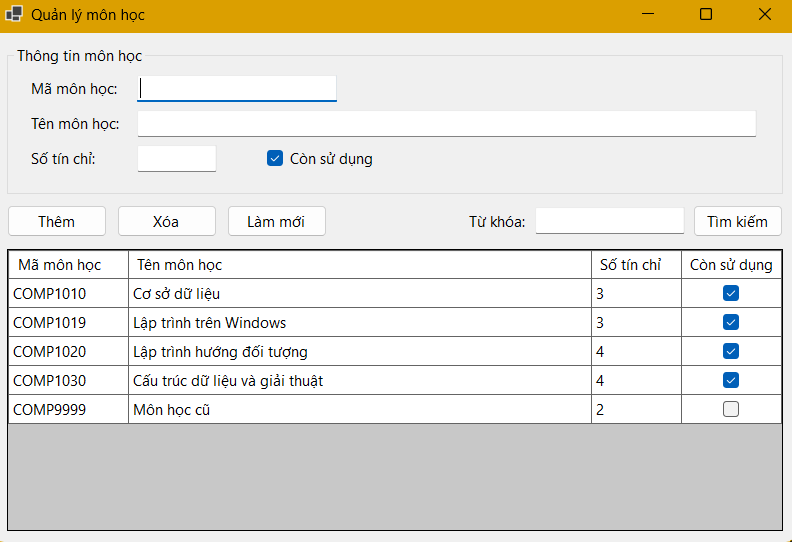
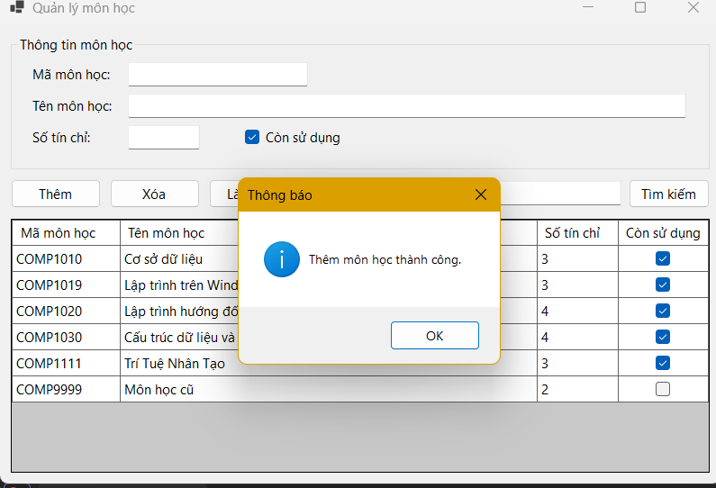
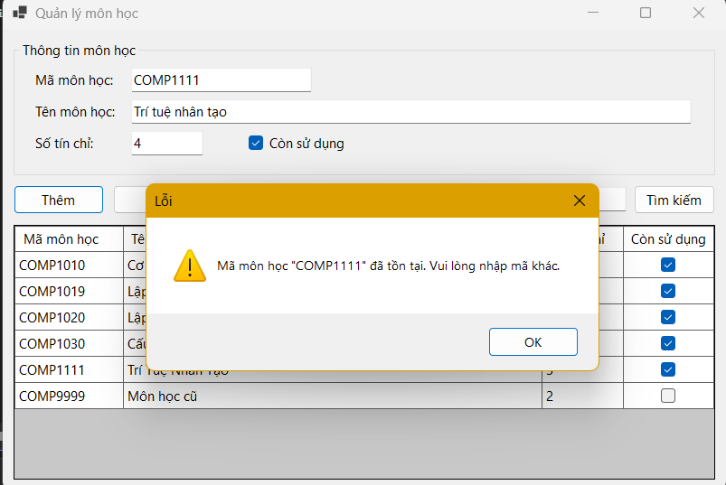
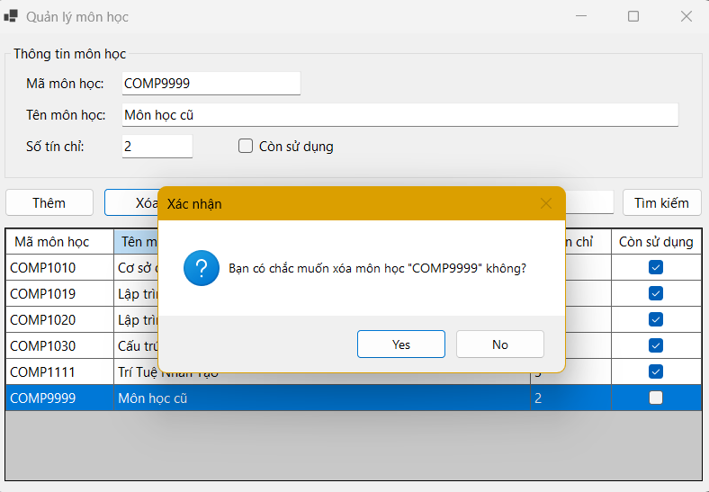
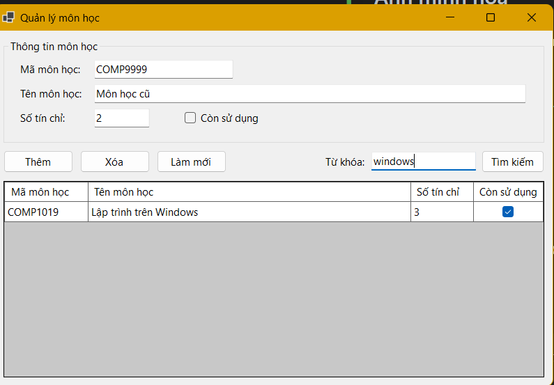

# LAB 15    
## 2611COMP101904-Lap-trinh-Windows
## Bài Lab: Lab 15  
## Họ tên sinh viên: Hoàng Minh Nhật
## MSSV: 51.01.104.066
## Nhóm 5

## Cấu trúc MVP

```
Models/MonHoc.cs                      # Model
Views/IMonHocView.cs, FrmMonHoc.cs    # View (Form implements interface)
Presenters/MonHocPresenter.cs         # Presenter (logic, validation)
Repositories/IMonHocRepository.cs     # Lưu/truy xuất dữ liệu (List<T>)
Repositories/MonHocRepository.cs
Program.cs
```

Luồng: `FrmMonHoc  →  MonHocPresenter  →  MonHocRepository`. Button Click chỉ gọi Presenter; Presenter chỉ làm việc với Form qua `IMonHocView`.

## Ảnh minh họa

**Giao diện khi mở chương trình (TC01)**



**Thêm môn học thành công (TC02)**



**Báo lỗi trùng mã (TC03)**



**Xác nhận và xóa môn học (TC04)**



**Kết quả tìm kiếm (TC05)**



